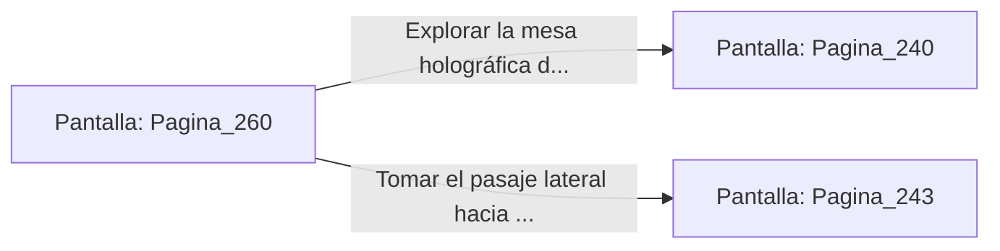

# 📺 Nodo Pantalla: `Pagina_260`

[[Index|⬅️ Índice]] | Fichero Origen: [[sample_eligejuego-code_capitulo_14_mpl|📄 sample/eligejuego-code/capitulo_14.mpl]]

**Narrativa y Encabezado:**
> PÁGINA 260: RUMBO AL SALÓN DEL CONSEJO
> 
> Decides dejar atrás el arsenal de la peana para no arriesgarte a activar las alarmas y continúas a paso ligero por la galería superior hacia el Salón del Consejo.
> 
> Cruzas el portón de bronce e ingresas en la estancia donde reposa la mesa holográfica del antiguo gobierno de Aethelgard.

## 📋 Desglose de Instrucciones de Opciones
### `OPCION "Explorar la mesa holográfica del Salón del Consejo" CON_ACCION TRANSICIONAR_A Pagina_240`
* **Instrucción:** `OPCION` *(Manual: Mapea una entrada o botón interactivo de usuario. Vincular una acción como la invocación de una función C1, un método C2 o una transición C3.)*
* **Efecto de Control:** Dispara `TRANSICIONAR_A` hacia [[Pantalla_Pagina_240|📺 Pagina_240]]
### `OPCION "Tomar el pasaje lateral hacia los Miradores de la Torre" CON_ACCION TRANSICIONAR_A Pagina_243`
* **Instrucción:** `OPCION` *(Manual: Mapea una entrada o botón interactivo de usuario. Vincular una acción como la invocación de una función C1, un método C2 o una transición C3.)*
* **Efecto de Control:** Dispara `TRANSICIONAR_A` hacia [[Pantalla_Pagina_243|📺 Pagina_243]]

## 📊 Diagrama de Flujo e Interacción (Mermaid)

