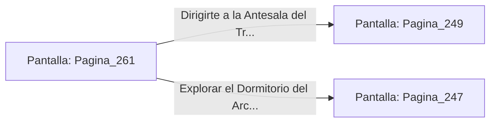

# 📺 Nodo Pantalla: `Pagina_261`

[[Index|⬅️ Índice]] | Fichero Origen: [[sample_eligejuego-code_capitulo_14_mpl|📄 sample/eligejuego-code/capitulo_14.mpl]]

**Narrativa y Encabezado:**
> PÁGINA 261: LA TARJETA MAESTRA
> 
> Te aproxima a la mesa holográfica y recuperas la tarjeta de nivel maestro. Al sincronizar la tarjeta con tu Brazal de Convergencia, desbloqueas el acceso absoluto a todas las compuertas blindadas y elevadores de la Torre del Trono.
> 
> La pantalla del tablero proyecta además un mapa en tiempo real de la Sala del Trono, revelando la ubicación exacta de los tres generadores de éter que alimentan la armadura del Inquisidor.
> 
> Con las credenciales maestras y los datos tácticos en tu haber, estás listo para irrumpir en la Antesala del Trono o en las dependencias privadas.

## 📋 Desglose de Instrucciones de Opciones
### `OPCION "Dirigirte a la Antesala del Trono para la irrupción final" CON_ACCION TRANSICIONAR_A Pagina_249`
* **Instrucción:** `OPCION` *(Manual: Mapea una entrada o botón interactivo de usuario. Vincular una acción como la invocación de una función C1, un método C2 o una transición C3.)*
* **Efecto de Control:** Dispara `TRANSICIONAR_A` hacia [[Pantalla_Pagina_249|📺 Pagina_249]]
### `OPCION "Explorar el Dormitorio del Archimago antes del combate" CON_ACCION TRANSICIONAR_A Pagina_247`
* **Instrucción:** `OPCION` *(Manual: Mapea una entrada o botón interactivo de usuario. Vincular una acción como la invocación de una función C1, un método C2 o una transición C3.)*
* **Efecto de Control:** Dispara `TRANSICIONAR_A` hacia [[Pantalla_Pagina_247|📺 Pagina_247]]

## 📊 Diagrama de Flujo e Interacción (Mermaid)

