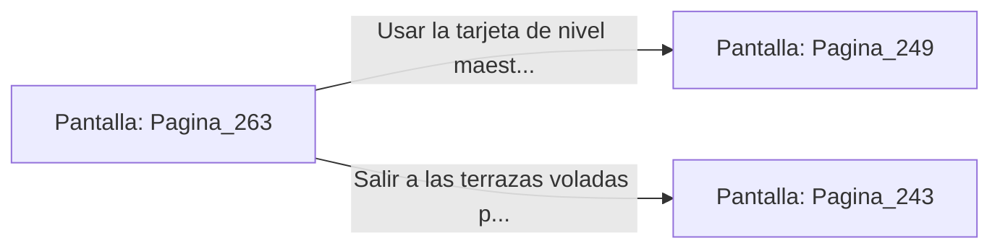

# 📺 Nodo Pantalla: `Pagina_263`

[[Index|⬅️ Índice]] | Fichero Origen: [[sample_eligejuego-code_capitulo_14_mpl|📄 sample/eligejuego-code/capitulo_14.mpl]]

**Narrativa y Encabezado:**
> PÁGINA 263: EL ACCESO DE LA GALERÍA DE LOS MÁRTIRES
> 
> Atraviesas la Galería de los Reyes Mártires llevando la cuerda de titanio y los viales curativos. Las miradas de mármol de los antiguos soberanos parecen acompañar tu marcha hacia el enfrentamiento definitivo.
> 
> Llegas al portón blindado de la Antesala del Trono. Tu Brazal de Convergencia emite un zumbido armónico al detectar la proximidad del Tercer Sello de Fase y la presencia del propio Malakor.
> 
> Debes decidir si usar la tarjeta de nivel maestro para abrir la puerta de la antesala o buscar una vía de infiltración por las terrazas voladas.

## 📋 Desglose de Instrucciones de Opciones
### `OPCION "Usar la tarjeta de nivel maestro para ingresar a la Antesala del Trono" CON_ACCION TRANSICIONAR_A Pagina_249`
* **Instrucción:** `OPCION` *(Manual: Mapea una entrada o botón interactivo de usuario. Vincular una acción como la invocación de una función C1, un método C2 o una transición C3.)*
* **Efecto de Control:** Dispara `TRANSICIONAR_A` hacia [[Pantalla_Pagina_249|📺 Pagina_249]]
### `OPCION "Salir a las terrazas voladas para buscar un acceso superior" CON_ACCION TRANSICIONAR_A Pagina_243`
* **Instrucción:** `OPCION` *(Manual: Mapea una entrada o botón interactivo de usuario. Vincular una acción como la invocación de una función C1, un método C2 o una transición C3.)*
* **Efecto de Control:** Dispara `TRANSICIONAR_A` hacia [[Pantalla_Pagina_243|📺 Pagina_243]]

## 📊 Diagrama de Flujo e Interacción (Mermaid)

