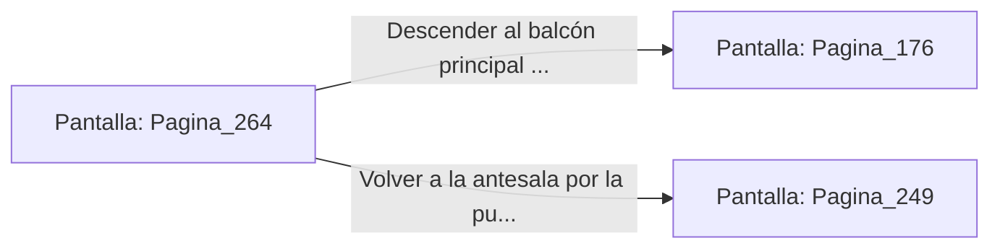

# 📺 Nodo Pantalla: `Pagina_264`

[[Index|⬅️ Índice]] | Fichero Origen: [[sample_eligejuego-code_capitulo_14_mpl|📄 sample/eligejuego-code/capitulo_14.mpl]]

**Narrativa y Encabezado:**
> PÁGINA 264: LAS TERRAZAS VOLADAS
> 
> Sales a las terrazas voladas de la cima de la torre enfrentando el viento helado de la tormenta de éter. Las barandillas de mármol tiemblan bajo los impactos de los relámpagos esmeralda.
> 
> Te descuelgas con la cuerda de titanio hacia el balcón principal de la Sala del Trono.

## 📋 Desglose de Instrucciones de Opciones
### `OPCION "Descender al balcón principal de la Sala del Trono" CON_ACCION TRANSICIONAR_A Pagina_176`
* **Instrucción:** `OPCION` *(Manual: Mapea una entrada o botón interactivo de usuario. Vincular una acción como la invocación de una función C1, un método C2 o una transición C3.)*
* **Efecto de Control:** Dispara `TRANSICIONAR_A` hacia [[Pantalla_Pagina_176|📺 Pagina_176]]
### `OPCION "Volver a la antesala por la puerta reforzada" CON_ACCION TRANSICIONAR_A Pagina_249`
* **Instrucción:** `OPCION` *(Manual: Mapea una entrada o botón interactivo de usuario. Vincular una acción como la invocación de una función C1, un método C2 o una transición C3.)*
* **Efecto de Control:** Dispara `TRANSICIONAR_A` hacia [[Pantalla_Pagina_249|📺 Pagina_249]]

## 📊 Diagrama de Flujo e Interacción (Mermaid)

