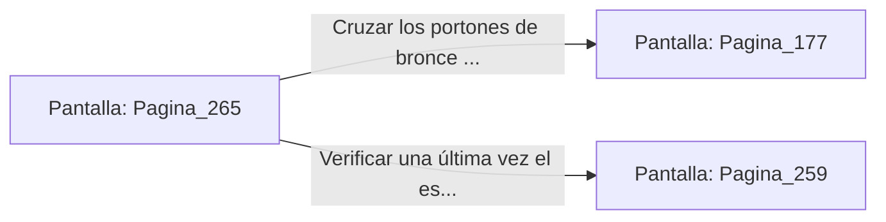

# 📺 Nodo Pantalla: `Pagina_265`

[[Index|⬅️ Índice]] | Fichero Origen: [[sample_eligejuego-code_capitulo_14_mpl|📄 sample/eligejuego-code/capitulo_14.mpl]]

**Narrativa y Encabezado:**
> PÁGINA 265: EL SANTUARIO PREPARADO
> 
> Ingresas en el Santuario de la Convergencia Final con tus armamentos sobrecargados y los dos sellos sincronizados en el Brazal. El prisma de obsidiana del altar brilla con un resplandor dorado intenso.
> 
> Sientes que la energía acumulada en tu dispositivo garantiza la máxima potencia para desintegrar el escudo del Inquisidor cuando comience el duelo final.
> 
> Frente a ti, los grandes portones de bronce de la Sala del Trono se entreabren lentamente, invitándote al destino final.

## 📋 Desglose de Instrucciones de Opciones
### `OPCION "Cruzar los portones de bronce e ingresar a la Sala del Trono" CON_ACCION TRANSICIONAR_A Pagina_177`
* **Instrucción:** `OPCION` *(Manual: Mapea una entrada o botón interactivo de usuario. Vincular una acción como la invocación de una función C1, un método C2 o una transición C3.)*
* **Efecto de Control:** Dispara `TRANSICIONAR_A` hacia [[Pantalla_Pagina_177|📺 Pagina_177]]
### `OPCION "Verificar una última vez el estado de tus cartuchos Cronal" CON_ACCION TRANSICIONAR_A Pagina_259`
* **Instrucción:** `OPCION` *(Manual: Mapea una entrada o botón interactivo de usuario. Vincular una acción como la invocación de una función C1, un método C2 o una transición C3.)*
* **Efecto de Control:** Dispara `TRANSICIONAR_A` hacia [[Pantalla_Pagina_259|📺 Pagina_259]]

## 📊 Diagrama de Flujo e Interacción (Mermaid)

