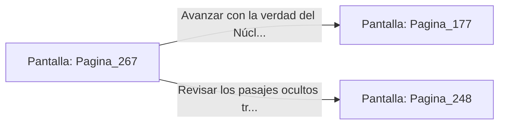

# 📺 Nodo Pantalla: `Pagina_267`

[[Index|⬅️ Índice]] | Fichero Origen: [[sample_eligejuego-code_capitulo_14_mpl|📄 sample/eligejuego-code/capitulo_14.mpl]]

**Narrativa y Encabezado:**
> PÁGINA 267: LAS REVELACIONES DEL DORMITORIO
> 
> Revisas los anaqueles del Dormitorio del Archimago tras consumir el elixir curativo. Entre los mapas arcanos encuentras el diagrama del Núcleo de Éter y el punto exacto donde se acopla el Tercer Sello de Fase.
> 
> Descubres que al arrancar el Tercer Sello del pecho de Malakor, el Núcleo iniciará una secuencia de purificación que restaurará las líneas temporales de Aethelgard.
> 
> Con la certeza absoluta de tu misión, abandonas las dependencias privadas rumbo a los portones del Trono.

## 📋 Desglose de Instrucciones de Opciones
### `OPCION "Avanzar con la verdad del Núcleo hacia la Sala del Trono" CON_ACCION TRANSICIONAR_A Pagina_177`
* **Instrucción:** `OPCION` *(Manual: Mapea una entrada o botón interactivo de usuario. Vincular una acción como la invocación de una función C1, un método C2 o una transición C3.)*
* **Efecto de Control:** Dispara `TRANSICIONAR_A` hacia [[Pantalla_Pagina_177|📺 Pagina_177]]
### `OPCION "Revisar los pasajes ocultos tras los tapices para ganar altura" CON_ACCION TRANSICIONAR_A Pagina_248`
* **Instrucción:** `OPCION` *(Manual: Mapea una entrada o botón interactivo de usuario. Vincular una acción como la invocación de una función C1, un método C2 o una transición C3.)*
* **Efecto de Control:** Dispara `TRANSICIONAR_A` hacia [[Pantalla_Pagina_248|📺 Pagina_248]]

## 📊 Diagrama de Flujo e Interacción (Mermaid)

