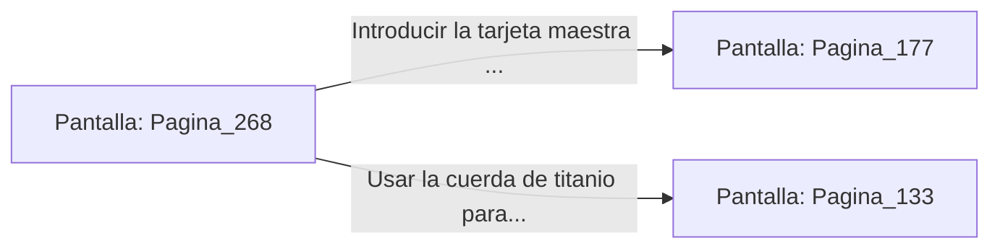

# 📺 Nodo Pantalla: `Pagina_268`

[[Index|⬅️ Índice]] | Fichero Origen: [[sample_eligejuego-code_capitulo_14_mpl|📄 sample/eligejuego-code/capitulo_14.mpl]]

**Narrativa y Encabezado:**
> PÁGINA 268: LA BARRICADA DE LA ANTESALA
> 
> Llegas a la Antesala del Trono desplegando el camuflaje térmico. Las dos estatuas biomecánicas de la entrada patrullan la zona con sus visores ópticos sin lograr fijar tu posición.
> 
> Sorteas la barricada de mármol y alcanzas el cierre principal de la puerta blindada del trono.

## 📋 Desglose de Instrucciones de Opciones
### `OPCION "Introducir la tarjeta maestra en el cierre de la puerta blindada" CON_ACCION TRANSICIONAR_A Pagina_177`
* **Instrucción:** `OPCION` *(Manual: Mapea una entrada o botón interactivo de usuario. Vincular una acción como la invocación de una función C1, un método C2 o una transición C3.)*
* **Efecto de Control:** Dispara `TRANSICIONAR_A` hacia [[Pantalla_Pagina_177|📺 Pagina_177]]
### `OPCION "Usar la cuerda de titanio para subir al tragaluz superior" CON_ACCION TRANSICIONAR_A Pagina_133`
* **Instrucción:** `OPCION` *(Manual: Mapea una entrada o botón interactivo de usuario. Vincular una acción como la invocación de una función C1, un método C2 o una transición C3.)*
* **Efecto de Control:** Dispara `TRANSICIONAR_A` hacia [[Pantalla_Pagina_133|📺 Pagina_133]]

## 📊 Diagrama de Flujo e Interacción (Mermaid)

