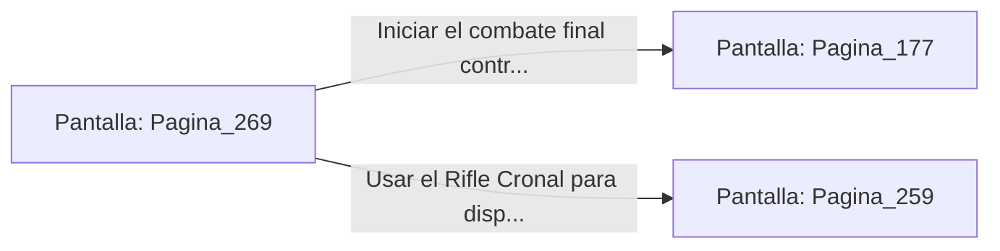

# 📺 Nodo Pantalla: `Pagina_269`

[[Index|⬅️ Índice]] | Fichero Origen: [[sample_eligejuego-code_capitulo_14_mpl|📄 sample/eligejuego-code/capitulo_14.mpl]]

**Narrativa y Encabezado:**
> PÁGINA 269: LA ENTRADA AL COMBATE FINAL
> 
> Insertas la tarjeta de nivel maestro en el panel de la Antesala del Trono. Las pesadas hojas acorazadas se retiran en los muros con un chasquido sordo, abriendo paso a la monumental Sala del Trono.
> 
> El Inquisidor Malakor se alza de su asiento de obsidiana envuelto en un aura de energía violeta. En su pecho brilla con furia el Tercer Sello de Fase, conectado directamente al flujo del Núcleo de Éter.
> 
> 'Has llegado lejos, viajero', resuena su voz distorsionada. Desenfundas tu arma y te preparas para el duelo definitivo por el destino de la realidad.

## 📋 Desglose de Instrucciones de Opciones
### `OPCION "Iniciar el combate final contra Malakor" CON_ACCION TRANSICIONAR_A Pagina_177`
* **Instrucción:** `OPCION` *(Manual: Mapea una entrada o botón interactivo de usuario. Vincular una acción como la invocación de una función C1, un método C2 o una transición C3.)*
* **Efecto de Control:** Dispara `TRANSICIONAR_A` hacia [[Pantalla_Pagina_177|📺 Pagina_177]]
### `OPCION "Usar el Rifle Cronal para disparar al Tercer Sello en su pecho" CON_ACCION TRANSICIONAR_A Pagina_259`
* **Instrucción:** `OPCION` *(Manual: Mapea una entrada o botón interactivo de usuario. Vincular una acción como la invocación de una función C1, un método C2 o una transición C3.)*
* **Efecto de Control:** Dispara `TRANSICIONAR_A` hacia [[Pantalla_Pagina_259|📺 Pagina_259]]

## 📊 Diagrama de Flujo e Interacción (Mermaid)

