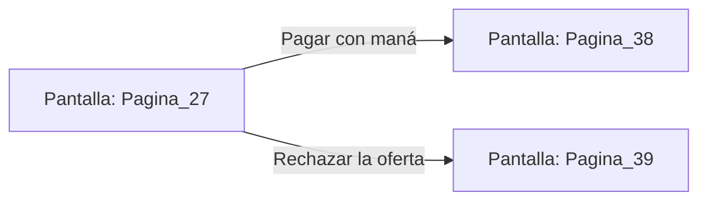

# 📺 Nodo Pantalla: `Pagina_27`

[[Index|⬅️ Índice]] | Fichero Origen: [[sample_eligejuego-code_capa3_vistas_2_mpl|📄 sample/eligejuego-code/capa3_vistas_2.mpl]]

**Encabezado Visual:** "Página 27: El Trato del Mercader"

## 📋 Desglose de Instrucciones de Opciones
### `OPCION "Pagar con maná" CON_ACCION TRANSICIONAR_A Pagina_38`
* **Instrucción:** `OPCION` *(Manual: Mapea una entrada o botón interactivo de usuario. Vincular una acción como la invocación de una función C1, un método C2 o una transición C3.)*
* **Efecto de Control:** Dispara `TRANSICIONAR_A` hacia [[Pantalla_Pagina_38|📺 Pagina_38]] *(Manual: Primitiva de control de flujo UI. Emite un evento asíncrono al Event Loop para cambiar la vista activa a la pantalla de destino.)*
### `OPCION "Rechazar la oferta" CON_ACCION TRANSICIONAR_A Pagina_39`
* **Instrucción:** `OPCION` *(Manual: Mapea una entrada o botón interactivo de usuario. Vincular una acción como la invocación de una función C1, un método C2 o una transición C3.)*
* **Efecto de Control:** Dispara `TRANSICIONAR_A` hacia [[Pantalla_Pagina_39|📺 Pagina_39]] *(Manual: Primitiva de control de flujo UI. Emite un evento asíncrono al Event Loop para cambiar la vista activa a la pantalla de destino.)*

## 📊 Diagrama de Flujo e Interacción (Mermaid)

