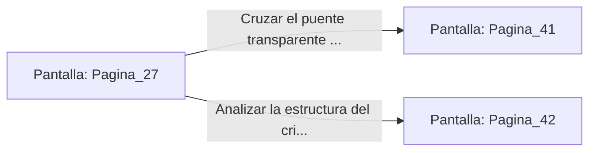

# 📺 Nodo Pantalla: `Pagina_27`

[[Index|⬅️ Índice]] | Fichero Origen: [[sample_eligejuego-code_capitulo_02_mpl|📄 sample/eligejuego-code/capitulo_02.mpl]]

**Narrativa y Encabezado:**
> PÁGINA 27: LA SALA DEL ABISMO Y LAS ILUSIONES
> 
> Llegas al borde de un precipicio aparentemente infranqueable. Sin embargo, recordando la nota del explorador, utilizas la Llave de Fase para disipar la ilusión óptica, revelando un puente transparente de cristal denso.

## 📋 Desglose de Instrucciones de Opciones
### `OPCION "Cruzar el puente transparente de cristal hacia el Sector Cero" CON_ACCION TRANSICIONAR_A Pagina_41`
* **Instrucción:** `OPCION` *(Manual: Mapea una entrada o botón interactivo de usuario. Vincular una acción como la invocación de una función C1, un método C2 o una transición C3.)*
* **Efecto de Control:** Dispara `TRANSICIONAR_A` hacia [[Pantalla_Pagina_41|📺 Pagina_41]]
### `OPCION "Analizar la estructura del cristal con el Brazal antes de cruzar" CON_ACCION TRANSICIONAR_A Pagina_42`
* **Instrucción:** `OPCION` *(Manual: Mapea una entrada o botón interactivo de usuario. Vincular una acción como la invocación de una función C1, un método C2 o una transición C3.)*
* **Efecto de Control:** Dispara `TRANSICIONAR_A` hacia [[Pantalla_Pagina_42|📺 Pagina_42]]

## 📊 Diagrama de Flujo e Interacción (Mermaid)

