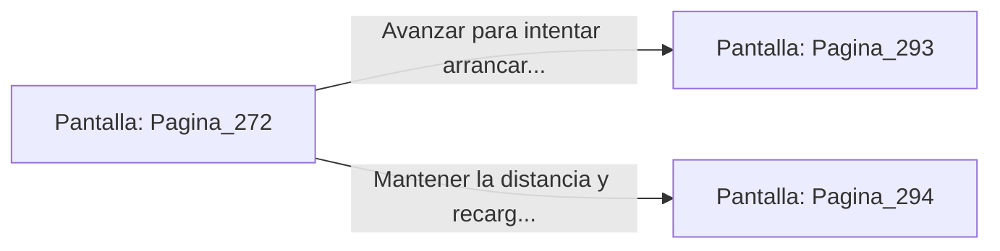

# 📺 Nodo Pantalla: `Pagina_272`

[[Index|⬅️ Índice]] | Fichero Origen: [[sample_eligejuego-code_capitulo_15_mpl|📄 sample/eligejuego-code/capitulo_15.mpl]]

**Narrativa y Encabezado:**
> PÁGINA 272: LA RÁFAGA DE CRONAL
> 
> Empuñas el Rifle de Pulso Cronal y descargas una ráfaga concentrada contra la coraza de Malakor. Los proyectiles de aceleración temporal atraviesan su escudo de fuerza, resquebrajando la placa pectoral que protege el Tercer Sello de Fase.
> 
> El Inquisidor retrocede varios pasos emitiendo un rugido de rabia mientras la energía violeta de su armadura parpadea con violencia.

## 📋 Desglose de Instrucciones de Opciones
### `OPCION "Avanzar para intentar arrancar el Tercer Sello de su pecho" CON_ACCION TRANSICIONAR_A Pagina_293`
* **Instrucción:** `OPCION` *(Manual: Mapea una entrada o botón interactivo de usuario. Vincular una acción como la invocación de una función C1, un método C2 o una transición C3.)*
* **Efecto de Control:** Dispara `TRANSICIONAR_A` hacia [[Pantalla_Pagina_293|📺 Pagina_293]]
### `OPCION "Mantener la distancia y recargar el Rifle Cronal" CON_ACCION TRANSICIONAR_A Pagina_294`
* **Instrucción:** `OPCION` *(Manual: Mapea una entrada o botón interactivo de usuario. Vincular una acción como la invocación de una función C1, un método C2 o una transición C3.)*
* **Efecto de Control:** Dispara `TRANSICIONAR_A` hacia [[Pantalla_Pagina_294|📺 Pagina_294]]

## 📊 Diagrama de Flujo e Interacción (Mermaid)

