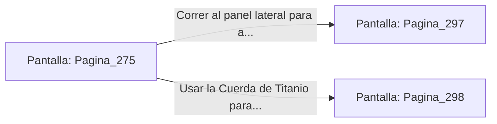

# 📺 Nodo Pantalla: `Pagina_275`

[[Index|⬅️ Índice]] | Fichero Origen: [[sample_eligejuego-code_capitulo_15_mpl|📄 sample/eligejuego-code/capitulo_15.mpl]]

**Narrativa y Encabezado:**
> PÁGINA 275: LA SOBRECARGA DEL NÚCLEO
> 
> Sintiendo la presión de tus ataques, Malakor extiende sus brazos y canaliza una corriente masiva de éter desde la columna central del Núcleo. La temperatura en la Sala del Trono se dispara e inmensos arcos voltaicos comienzan a recorrer las paredes de mármol.
> 
> La sobrecarga amenaza con colapsar los condensadores de la sala y desencadenar un fogonazo de plasma capaz de abrasar todo el recinto. Un panel de purga de emergencia se halla a pocos metros a tu izquierda.
> 
> Tienes la opción de correr al panel para activar la purga de refrigerante o usar la Cuerda de Titanio para subir a la cúpula y esquivar la onda expansiva desde el aire.

## 📋 Desglose de Instrucciones de Opciones
### `OPCION "Correr al panel lateral para activar la purga de refrigerante" CON_ACCION TRANSICIONAR_A Pagina_297`
* **Instrucción:** `OPCION` *(Manual: Mapea una entrada o botón interactivo de usuario. Vincular una acción como la invocación de una función C1, un método C2 o una transición C3.)*
* **Efecto de Control:** Dispara `TRANSICIONAR_A` hacia [[Pantalla_Pagina_297|📺 Pagina_297]]
### `OPCION "Usar la Cuerda de Titanio para subir a la cúpula y ganar altura" CON_ACCION TRANSICIONAR_A Pagina_298`
* **Instrucción:** `OPCION` *(Manual: Mapea una entrada o botón interactivo de usuario. Vincular una acción como la invocación de una función C1, un método C2 o una transición C3.)*
* **Efecto de Control:** Dispara `TRANSICIONAR_A` hacia [[Pantalla_Pagina_298|📺 Pagina_298]]

## 📊 Diagrama de Flujo e Interacción (Mermaid)

