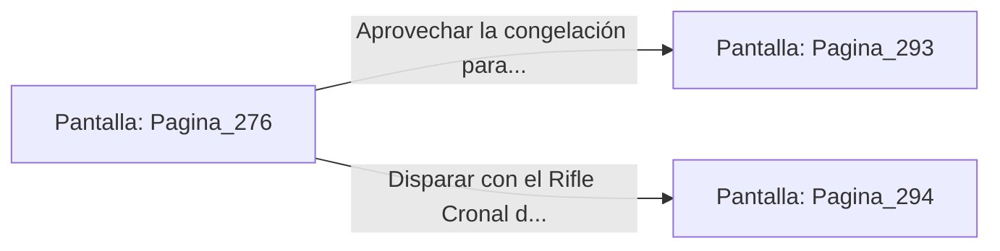

# 📺 Nodo Pantalla: `Pagina_276`

[[Index|⬅️ Índice]] | Fichero Origen: [[sample_eligejuego-code_capitulo_15_mpl|📄 sample/eligejuego-code/capitulo_15.mpl]]

**Narrativa y Encabezado:**
> PÁGINA 276: LA PURGA DEL REFRIGERANTE EN EL TRONO
> 
> Accionas la palanca del panel de purga y una densa cortina de vapor subcero inunda la Sala del Trono. La rápida caída de temperatura neutraliza la sobrecarga de plasma y congela las articulaciones biomecánicas de la armadura de Malakor.
> 
> Atrapado por la escarcha, el Inquisidor lucha torpemente por liberarse mientras el Tercer Sello en su pecho parpadea expuesto.

## 📋 Desglose de Instrucciones de Opciones
### `OPCION "Aprovechar la congelación para embestir a Malakor y tomar el Tercer Sello" CON_ACCION TRANSICIONAR_A Pagina_293`
* **Instrucción:** `OPCION` *(Manual: Mapea una entrada o botón interactivo de usuario. Vincular una acción como la invocación de una función C1, un método C2 o una transición C3.)*
* **Efecto de Control:** Dispara `TRANSICIONAR_A` hacia [[Pantalla_Pagina_293|📺 Pagina_293]]
### `OPCION "Disparar con el Rifle Cronal directamente al sello inmovilizado" CON_ACCION TRANSICIONAR_A Pagina_294`
* **Instrucción:** `OPCION` *(Manual: Mapea una entrada o botón interactivo de usuario. Vincular una acción como la invocación de una función C1, un método C2 o una transición C3.)*
* **Efecto de Control:** Dispara `TRANSICIONAR_A` hacia [[Pantalla_Pagina_294|📺 Pagina_294]]

## 📊 Diagrama de Flujo e Interacción (Mermaid)

