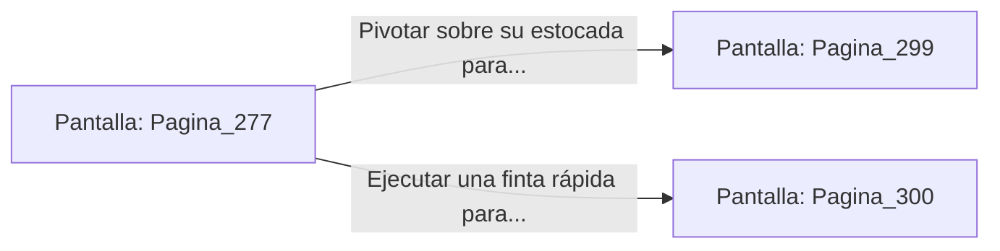

# 📺 Nodo Pantalla: `Pagina_277`

[[Index|⬅️ Índice]] | Fichero Origen: [[sample_eligejuego-code_capitulo_15_mpl|📄 sample/eligejuego-code/capitulo_15.mpl]]

**Narrativa y Encabezado:**
> PÁGINA 277: EL DUELO EN LOS BALCONES
> 
> El combate se traslada a los balcones exteriores de la Sala del Trono. El viento glacial de la tormenta de éter azota las capas de los combatientes mientras los relámpagos esmeralda iluminan el chocar de vuestras armas sobre la piedra humedecida.
> 
> Malakor intenta arrinconarte contra la balaustrada de mármol, descargando una serie de estocadas rápidas dirigidas a tu torso. Tu Escudo Deflector aborbe parte de los impactos, pero la tensión desgasta la estructura del balcón.
> 
> Puedes usar el impulso de su propia estocada para pivotar y lanzarlo contra el abismo o ejecutar una finta rápida para volver al interior de la sala.

## 📋 Desglose de Instrucciones de Opciones
### `OPCION "Pivotar sobre su estocada para empujar a Malakor hacia el abismo" CON_ACCION TRANSICIONAR_A Pagina_299`
* **Instrucción:** `OPCION` *(Manual: Mapea una entrada o botón interactivo de usuario. Vincular una acción como la invocación de una función C1, un método C2 o una transición C3.)*
* **Efecto de Control:** Dispara `TRANSICIONAR_A` hacia [[Pantalla_Pagina_299|📺 Pagina_299]]
### `OPCION "Ejecutar una finta rápida para reingresar a la nave de la Sala del Trono" CON_ACCION TRANSICIONAR_A Pagina_300`
* **Instrucción:** `OPCION` *(Manual: Mapea una entrada o botón interactivo de usuario. Vincular una acción como la invocación de una función C1, un método C2 o una transición C3.)*
* **Efecto de Control:** Dispara `TRANSICIONAR_A` hacia [[Pantalla_Pagina_300|📺 Pagina_300]]

## 📊 Diagrama de Flujo e Interacción (Mermaid)

