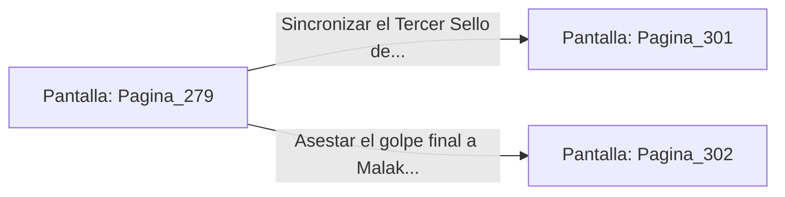

# 📺 Nodo Pantalla: `Pagina_279`

[[Index|⬅️ Índice]] | Fichero Origen: [[sample_eligejuego-code_capitulo_15_mpl|📄 sample/eligejuego-code/capitulo_15.mpl]]

**Narrativa y Encabezado:**
> PÁGINA 279: LA RUPTURA DEL TERCER SELLO
> 
> Logras cerrar la distancia y clavas tu estoque de luz directamente en la ranura de acople del Tercer Sello de Fase. Un chispazo azulino cegador estalla en el pecho de Malakor mientras el anclaje místico de la reliquia se fractura con un estruendo metálico.
> 
> El Tercer Sello se desprende de la armadura del Inquisidor y cae sobre la alfombra carmesí. Malakor emite un alarido de agonía al ser desconectado del flujo directo del Núcleo de Éter, cayendo de rodillas malherido.
> 
> Te abalanzas sobre la reliquia y la sujetas con firmeza. Es el momento de sincronizar el último sello en tu Brazal de Convergencia.

## 📋 Desglose de Instrucciones de Opciones
### `OPCION "Sincronizar el Tercer Sello de Fase en tu Brazal de Convergencia" CON_ACCION TRANSICIONAR_A Pagina_301`
* **Instrucción:** `OPCION` *(Manual: Mapea una entrada o botón interactivo de usuario. Vincular una acción como la invocación de una función C1, un método C2 o una transición C3.)*
* **Efecto de Control:** Dispara `TRANSICIONAR_A` hacia [[Pantalla_Pagina_301|📺 Pagina_301]]
### `OPCION "Asestar el golpe final a Malakor antes de tomar el sello" CON_ACCION TRANSICIONAR_A Pagina_302`
* **Instrucción:** `OPCION` *(Manual: Mapea una entrada o botón interactivo de usuario. Vincular una acción como la invocación de una función C1, un método C2 o una transición C3.)*
* **Efecto de Control:** Dispara `TRANSICIONAR_A` hacia [[Pantalla_Pagina_302|📺 Pagina_302]]

## 📊 Diagrama de Flujo e Interacción (Mermaid)

