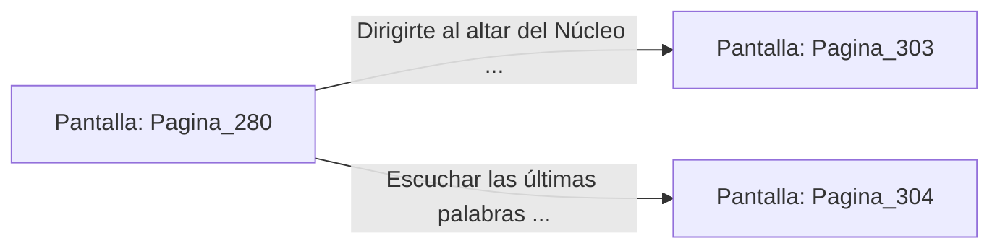

# 📺 Nodo Pantalla: `Pagina_280`

[[Index|⬅️ Índice]] | Fichero Origen: [[sample_eligejuego-code_capitulo_15_mpl|📄 sample/eligejuego-code/capitulo_15.mpl]]

**Narrativa y Encabezado:**
> PÁGINA 280: LA TRIPLE SINCRONIZACIÓN
> 
> Introduces el Tercer Sello de Fase en la última ranura vacía de tu Brazal. Una pátina de luz dorada envuelve tu cuerpo mientras las tres reliquias de fase resuenan al unísono, restaurando al cien por cien la integridad del dispositivo.
> 
> Con la secuencia completa, el Brazal desbloquea la función de Purga Cronal, la única capacidad capaz de estabilizar el Núcleo de Éter y cerrar las grietas de la realidad.

## 📋 Desglose de Instrucciones de Opciones
### `OPCION "Dirigirte al altar del Núcleo de Éter para iniciar la Purga Cronal" CON_ACCION TRANSICIONAR_A Pagina_303`
* **Instrucción:** `OPCION` *(Manual: Mapea una entrada o botón interactivo de usuario. Vincular una acción como la invocación de una función C1, un método C2 o una transición C3.)*
* **Efecto de Control:** Dispara `TRANSICIONAR_A` hacia [[Pantalla_Pagina_303|📺 Pagina_303]]
### `OPCION "Escuchar las últimas palabras de Malakor desarmado" CON_ACCION TRANSICIONAR_A Pagina_304`
* **Instrucción:** `OPCION` *(Manual: Mapea una entrada o botón interactivo de usuario. Vincular una acción como la invocación de una función C1, un método C2 o una transición C3.)*
* **Efecto de Control:** Dispara `TRANSICIONAR_A` hacia [[Pantalla_Pagina_304|📺 Pagina_304]]

## 📊 Diagrama de Flujo e Interacción (Mermaid)

