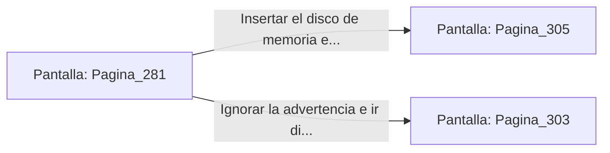

# 📺 Nodo Pantalla: `Pagina_281`

[[Index|⬅️ Índice]] | Fichero Origen: [[sample_eligejuego-code_capitulo_15_mpl|📄 sample/eligejuego-code/capitulo_15.mpl]]

**Narrativa y Encabezado:**
> PÁGINA 281: LAS ÚLTIMAS PALABRAS DEL INQUISIDOR
> 
> Te aproximas a Malakor, quien yace de rodillas sobre el mármol ensangrentado. La corrupción violeta de su rostro se disipa gradualmente al extinguirse el vínculo con el Núcleo, revelando los rasgos cansados y humanos del antiguo Archimago.
> 
> 'No comprendes... el Colapso de Mnemósine no fue un accidente', susurra con voz débil. 'Alguien desde el Sector Cero forzó la ruptura para devorar las líneas temporales. Si estabilizas el Núcleo sin purgar el Código Cero... la realidad se fragmentará para siempre'.
> 
> Con su último aliento, Malakor te entrega un disco de memoria codificado antes de quedar inerte sobre la alfombra.

## 📋 Desglose de Instrucciones de Opciones
### `OPCION "Insertar el disco de memoria en tu Brazal para analizar el Código Cero" CON_ACCION TRANSICIONAR_A Pagina_305`
* **Instrucción:** `OPCION` *(Manual: Mapea una entrada o botón interactivo de usuario. Vincular una acción como la invocación de una función C1, un método C2 o una transición C3.)*
* **Efecto de Control:** Dispara `TRANSICIONAR_A` hacia [[Pantalla_Pagina_305|📺 Pagina_305]]
### `OPCION "Ignorar la advertencia e ir directamente a activar la Purga Cronal" CON_ACCION TRANSICIONAR_A Pagina_303`
* **Instrucción:** `OPCION` *(Manual: Mapea una entrada o botón interactivo de usuario. Vincular una acción como la invocación de una función C1, un método C2 o una transición C3.)*
* **Efecto de Control:** Dispara `TRANSICIONAR_A` hacia [[Pantalla_Pagina_303|📺 Pagina_303]]

## 📊 Diagrama de Flujo e Interacción (Mermaid)

