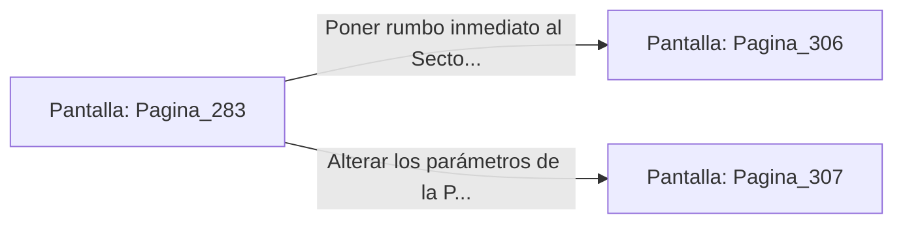

# 📺 Nodo Pantalla: `Pagina_283`

[[Index|⬅️ Índice]] | Fichero Origen: [[sample_eligejuego-code_capitulo_15_mpl|📄 sample/eligejuego-code/capitulo_15.mpl]]

**Narrativa y Encabezado:**
> PÁGINA 283: EL DISCO DEL CÓDIGO CERO
> 
> Insertas el disco de memoria de Malakor en la ranura de interfaz de tu Brazal. La pantalla holográfica despliega una serie de esquemas ultrasecretos que confirman sus palabras: la entidad conocida como la Archivista Vaelia ha estado manipulando los acontecimientos desde el principio.
> 
> Vaelia no buscaba salvar Aethelgard, sino absorber la energía de las 600 Cámaras a través de la interfaz de tu Brazal una vez que la Purga Cronal estuviera lista.
> 
> Con el engaño al descubierto, comprendes que para salvar la realidad debes adentrarte en el Sector Cero y neutralizar la proyección holográfica de Vaelia.

## 📋 Desglose de Instrucciones de Opciones
### `OPCION "Poner rumbo inmediato al Sector Cero para enfrentar a Vaelia" CON_ACCION TRANSICIONAR_A Pagina_306`
* **Instrucción:** `OPCION` *(Manual: Mapea una entrada o botón interactivo de usuario. Vincular una acción como la invocación de una función C1, un método C2 o una transición C3.)*
* **Efecto de Control:** Dispara `TRANSICIONAR_A` hacia [[Pantalla_Pagina_306|📺 Pagina_306]]
### `OPCION "Alterar los parámetros de la Purga Cronal para crear una trampa" CON_ACCION TRANSICIONAR_A Pagina_307`
* **Instrucción:** `OPCION` *(Manual: Mapea una entrada o botón interactivo de usuario. Vincular una acción como la invocación de una función C1, un método C2 o una transición C3.)*
* **Efecto de Control:** Dispara `TRANSICIONAR_A` hacia [[Pantalla_Pagina_307|📺 Pagina_307]]

## 📊 Diagrama de Flujo e Interacción (Mermaid)

