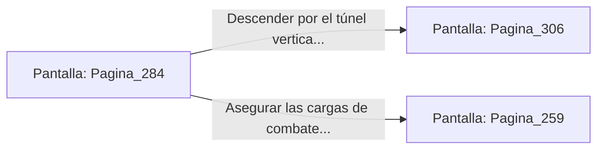

# 📺 Nodo Pantalla: `Pagina_284`

[[Index|⬅️ Índice]] | Fichero Origen: [[sample_eligejuego-code_capitulo_15_mpl|📄 sample/eligejuego-code/capitulo_15.mpl]]

**Narrativa y Encabezado:**
> PÁGINA 284: EL CAMINO AL SECTOR CERO
> 
> Abres la escotilla sellada tras el pedestal del trono que conduce a las profundidades del Sector Cero. Un túnel vertical iluminado por anillos de energía dorada desciende hacia el corazón de la ciudadela.
> 
> Desciendes a paso ligero sintiendo la tremenda presión espacio-temporal que emana de las cámaras inferiores.

## 📋 Desglose de Instrucciones de Opciones
### `OPCION "Descender por el túnel vertical hacia la Cámara del Núcleo Cero" CON_ACCION TRANSICIONAR_A Pagina_306`
* **Instrucción:** `OPCION` *(Manual: Mapea una entrada o botón interactivo de usuario. Vincular una acción como la invocación de una función C1, un método C2 o una transición C3.)*
* **Efecto de Control:** Dispara `TRANSICIONAR_A` hacia [[Pantalla_Pagina_306|📺 Pagina_306]]
### `OPCION "Asegurar las cargas de combate de tu arma antes del descenso" CON_ACCION TRANSICIONAR_A Pagina_259`
* **Instrucción:** `OPCION` *(Manual: Mapea una entrada o botón interactivo de usuario. Vincular una acción como la invocación de una función C1, un método C2 o una transición C3.)*
* **Efecto de Control:** Dispara `TRANSICIONAR_A` hacia [[Pantalla_Pagina_259|📺 Pagina_259]]

## 📊 Diagrama de Flujo e Interacción (Mermaid)

