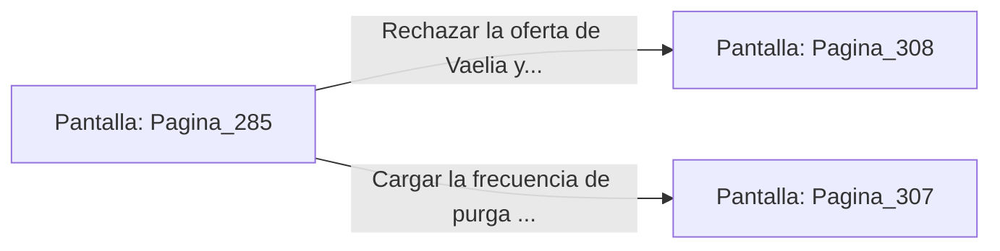

# 📺 Nodo Pantalla: `Pagina_285`

[[Index|⬅️ Índice]] | Fichero Origen: [[sample_eligejuego-code_capitulo_15_mpl|📄 sample/eligejuego-code/capitulo_15.mpl]]

**Narrativa y Encabezado:**
> PÁGINA 285: LA ANTESALA DEL NÚCLEO CERO
> 
> Llegas a la monumental Antesala del Núcleo Cero. Inmensas estructuras de cristal transparente contienen el flujo primario de la realidad, mientras el zumbido del Cronoclave vibra en tus huesos con una intensidad casi insoportable.
> 
> En el centro de la nave flota la figura de la Archivista Vaelia, despojada ya de sus interferencias y luciendo un cuerpo de pura energía astral de éter.
> 
> 'Veo que has descubierto la verdad, viajero', resuena su voz armónica. 'Pero tu Brazal ya contiene la energía de los tres sellos. Entrégame el dispositivo y serás inmortal en la nueva línea temporal'.

## 📋 Desglose de Instrucciones de Opciones
### `OPCION "Rechazar la oferta de Vaelia y desenfundar tu arma de fase" CON_ACCION TRANSICIONAR_A Pagina_308`
* **Instrucción:** `OPCION` *(Manual: Mapea una entrada o botón interactivo de usuario. Vincular una acción como la invocación de una función C1, un método C2 o una transición C3.)*
* **Efecto de Control:** Dispara `TRANSICIONAR_A` hacia [[Pantalla_Pagina_308|📺 Pagina_308]]
### `OPCION "Cargar la frecuencia de purga modificada en tu Brazal de Convergencia" CON_ACCION TRANSICIONAR_A Pagina_307`
* **Instrucción:** `OPCION` *(Manual: Mapea una entrada o botón interactivo de usuario. Vincular una acción como la invocación de una función C1, un método C2 o una transición C3.)*
* **Efecto de Control:** Dispara `TRANSICIONAR_A` hacia [[Pantalla_Pagina_307|📺 Pagina_307]]

## 📊 Diagrama de Flujo e Interacción (Mermaid)

