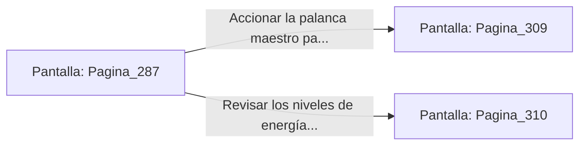

# 📺 Nodo Pantalla: `Pagina_287`

[[Index|⬅️ Índice]] | Fichero Origen: [[sample_eligejuego-code_capitulo_15_mpl|📄 sample/eligejuego-code/capitulo_15.mpl]]

**Narrativa y Encabezado:**
> PÁGINA 287: LA TRAMPA DEL CÓDIGO PURGADO
> 
> Conectas tu Brazal a la consola del Sector Cero e inicias la transferencia de la frecuencia de purga modificada. Vaelia se abalanza sobre el flujo de datos intentando absorber la energía del dispositivo.
> 
> Al tocar la interfaz, la trampa mnemónica diseñada con los datos de Malakor se activa, atrapando la esencia astral de Vaelia en una matriz de contención cuántica de la que no puede escapar.
> 
> La entidad grita de rabia mientras es sellada en el interior de un cristal de éter. La consola del Núcleo queda libre a tu disposición para la estabilización definitiva.

## 📋 Desglose de Instrucciones de Opciones
### `OPCION "Accionar la palanca maestro para ejecutar la estabilización del Núcleo" CON_ACCION TRANSICIONAR_A Pagina_309`
* **Instrucción:** `OPCION` *(Manual: Mapea una entrada o botón interactivo de usuario. Vincular una acción como la invocación de una función C1, un método C2 o una transición C3.)*
* **Efecto de Control:** Dispara `TRANSICIONAR_A` hacia [[Pantalla_Pagina_309|📺 Pagina_309]]
### `OPCION "Revisar los niveles de energía de las 600 Cámaras antes del sellado" CON_ACCION TRANSICIONAR_A Pagina_310`
* **Instrucción:** `OPCION` *(Manual: Mapea una entrada o botón interactivo de usuario. Vincular una acción como la invocación de una función C1, un método C2 o una transición C3.)*
* **Efecto de Control:** Dispara `TRANSICIONAR_A` hacia [[Pantalla_Pagina_310|📺 Pagina_310]]

## 📊 Diagrama de Flujo e Interacción (Mermaid)

