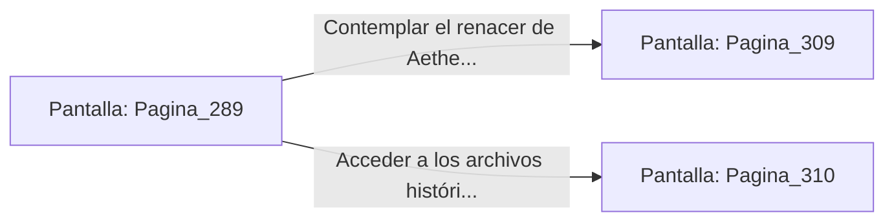

# 📺 Nodo Pantalla: `Pagina_289`

[[Index|⬅️ Índice]] | Fichero Origen: [[sample_eligejuego-code_capitulo_15_mpl|📄 sample/eligejuego-code/capitulo_15.mpl]]

**Narrativa y Encabezado:**
> PÁGINA 289: LA ESTABILIZACIÓN DEFINITIVA
> 
> Introduces el Brazal de Convergencia en el conector principal del Núcleo de Éter. Las tres reliquias de fase emiten un haz de luz dorada convergente que penetra en la columna de plasma, unificando las frecuencias espacio-temporales dispares.
> 
> El zumbido del Cronoclave cesa gradualmente para dar paso a un tono armónico suave y constante. Las grietas de la realidad en Aethelgard comienzan a cerrarse una a una a lo largo de las 600 Cámaras.
> 
> Has completado tu misión suprema. El Colapso de Mnemósine ha sido neutralizado y el futuro de las líneas temporales está a salvo.

## 📋 Desglose de Instrucciones de Opciones
### `OPCION "Contemplar el renacer de Aethelgard desde la plataforma del Núcleo" CON_ACCION TRANSICIONAR_A Pagina_309`
* **Instrucción:** `OPCION` *(Manual: Mapea una entrada o botón interactivo de usuario. Vincular una acción como la invocación de una función C1, un método C2 o una transición C3.)*
* **Efecto de Control:** Dispara `TRANSICIONAR_A` hacia [[Pantalla_Pagina_309|📺 Pagina_309]]
### `OPCION "Acceder a los archivos históricos para documentar tu hazaña" CON_ACCION TRANSICIONAR_A Pagina_310`
* **Instrucción:** `OPCION` *(Manual: Mapea una entrada o botón interactivo de usuario. Vincular una acción como la invocación de una función C1, un método C2 o una transición C3.)*
* **Efecto de Control:** Dispara `TRANSICIONAR_A` hacia [[Pantalla_Pagina_310|📺 Pagina_310]]

## 📊 Diagrama de Flujo e Interacción (Mermaid)

