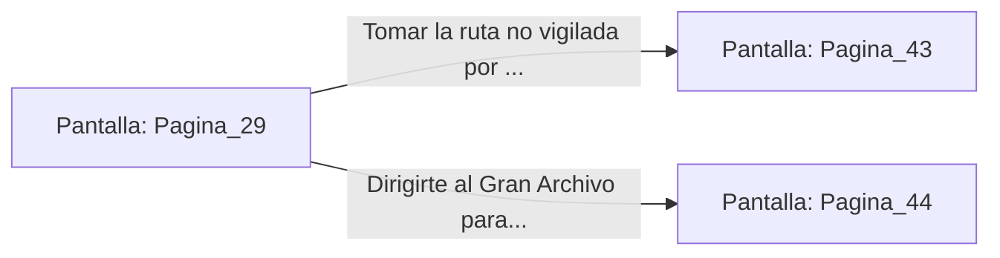

# 📺 Nodo Pantalla: `Pagina_29`

[[Index|⬅️ Índice]] | Fichero Origen: [[sample_eligejuego-code_capitulo_02_mpl|📄 sample/eligejuego-code/capitulo_02.mpl]]

**Narrativa y Encabezado:**
> PÁGINA 29: DESCARGA DE DATOS CARTOGRÁFICOS
> 
> Conectas tu Brazal de Convergencia a la terminal e inicias la transferencia. La barra de progreso avanza rápidamente mientras los esquemas topográficos de las 600 Cámaras se transfieren directamente a tu memoria óptica.
> 
> Entre los datos obtenidos, descubres que la cámara del Inquisidor Malakor está protegida por tres sellos de fase distribuidos en las secciones de los Archivos, los Jardines Sintéticos y el Bastión de Guerra. Además, identificas una ruta secundaria no vigilada a través de las cloacas purificadoras.
> 
> Con la descarga completada, desconectas la interfaz justo cuando la patrulla de autómatas inicia una ronda de verificación.

## 📋 Desglose de Instrucciones de Opciones
### `OPCION "Tomar la ruta no vigilada por las cloacas purificadoras" CON_ACCION TRANSICIONAR_A Pagina_43`
* **Instrucción:** `OPCION` *(Manual: Mapea una entrada o botón interactivo de usuario. Vincular una acción como la invocación de una función C1, un método C2 o una transición C3.)*
* **Efecto de Control:** Dispara `TRANSICIONAR_A` hacia [[Pantalla_Pagina_43|📺 Pagina_43]]
### `OPCION "Dirigirte al Gran Archivo para buscar el primer sello de fase" CON_ACCION TRANSICIONAR_A Pagina_44`
* **Instrucción:** `OPCION` *(Manual: Mapea una entrada o botón interactivo de usuario. Vincular una acción como la invocación de una función C1, un método C2 o una transición C3.)*
* **Efecto de Control:** Dispara `TRANSICIONAR_A` hacia [[Pantalla_Pagina_44|📺 Pagina_44]]

## 📊 Diagrama de Flujo e Interacción (Mermaid)

