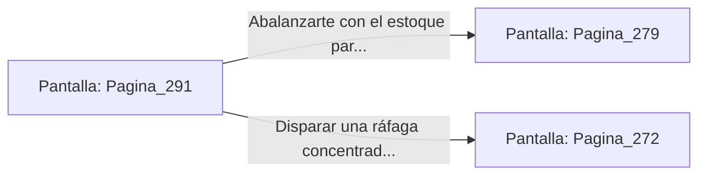

# 📺 Nodo Pantalla: `Pagina_291`

[[Index|⬅️ Índice]] | Fichero Origen: [[sample_eligejuego-code_capitulo_16_mpl|📄 sample/eligejuego-code/capitulo_16.mpl]]

**Narrativa y Encabezado:**
> PÁGINA 291: DISPARO AL PUNTO CIEGO
> 
> Alineas la mira de tu arma sobre el hombro izquierdo de Malakor en el instante preciso en que su barrera refractaria cede por la recarga energética. El proyectil de fase atraviesa la juntura de titanio, provocando una violenta explosión de chispas violetas que inutiliza el generador de escudos del Inquisidor.
> 
> Malakor se tambalea soltando un rugido de rabia. La armadura de combate pierde más del cincuenta por ciento de sus defensas automáticas, dejando expuesto el enganche místico del Tercer Sello de Fase en su pecho.
> 
> Es tu oportunidad de rematar el enfrentamiento: puedes abalanzarte con tu estoque de luz para arrancar la reliquia o usar la ráfaga concentrada del Rifle Cronal.

## 📋 Desglose de Instrucciones de Opciones
### `OPCION "Abalanzarte con el estoque para arrancar el Tercer Sello de su pecho" CON_ACCION TRANSICIONAR_A Pagina_279`
* **Instrucción:** `OPCION` *(Manual: Mapea una entrada o botón interactivo de usuario. Vincular una acción como la invocación de una función C1, un método C2 o una transición C3.)*
* **Efecto de Control:** Dispara `TRANSICIONAR_A` hacia [[Pantalla_Pagina_279|📺 Pagina_279]]
### `OPCION "Disparar una ráfaga concentrada con el Rifle Cronal" CON_ACCION TRANSICIONAR_A Pagina_272`
* **Instrucción:** `OPCION` *(Manual: Mapea una entrada o botón interactivo de usuario. Vincular una acción como la invocación de una función C1, un método C2 o una transición C3.)*
* **Efecto de Control:** Dispara `TRANSICIONAR_A` hacia [[Pantalla_Pagina_272|📺 Pagina_272]]

## 📊 Diagrama de Flujo e Interacción (Mermaid)

