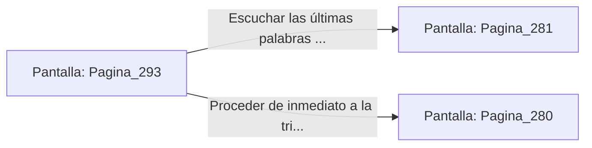

# 📺 Nodo Pantalla: `Pagina_293`

[[Index|⬅️ Índice]] | Fichero Origen: [[sample_eligejuego-code_capitulo_16_mpl|📄 sample/eligejuego-code/capitulo_16.mpl]]

**Narrativa y Encabezado:**
> PÁGINA 293: LA EXTRACCIÓN DEL TERCER SELLO
> 
> Te abalanzas sobre el Inquisidor desarmado y clavas la garra magnética de tu Brazal de Convergencia directamente sobre el receptáculo de su pecho. Una descarga eléctrica de alto voltaje recorre tus brazos mientras los anclajes del Tercer Sello de Fase se desgajan con un estruendo metálico.
> 
> El Tercer Sello se desprende desprendiendo destellos dorados y Malakor cae inerte sobre la peana del trono, liberado finalmente de la corrupción del Núcleo de Éter. El Inquisidor parpadea con debilidad y extiende una mano trémula entregándote un disco de datos.
> 
> Con los tres sellos reunidos, debes decidir si escuchar las últimas palabras del Inquisidor o proceder inmediatamente a la triple sincronización de tu Brazal.

## 📋 Desglose de Instrucciones de Opciones
### `OPCION "Escuchar las últimas palabras de Malakor e inspeccionar el disco" CON_ACCION TRANSICIONAR_A Pagina_281`
* **Instrucción:** `OPCION` *(Manual: Mapea una entrada o botón interactivo de usuario. Vincular una acción como la invocación de una función C1, un método C2 o una transición C3.)*
* **Efecto de Control:** Dispara `TRANSICIONAR_A` hacia [[Pantalla_Pagina_281|📺 Pagina_281]]
### `OPCION "Proceder de inmediato a la triple sincronización de los sellos" CON_ACCION TRANSICIONAR_A Pagina_280`
* **Instrucción:** `OPCION` *(Manual: Mapea una entrada o botón interactivo de usuario. Vincular una acción como la invocación de una función C1, un método C2 o una transición C3.)*
* **Efecto de Control:** Dispara `TRANSICIONAR_A` hacia [[Pantalla_Pagina_280|📺 Pagina_280]]

## 📊 Diagrama de Flujo e Interacción (Mermaid)

