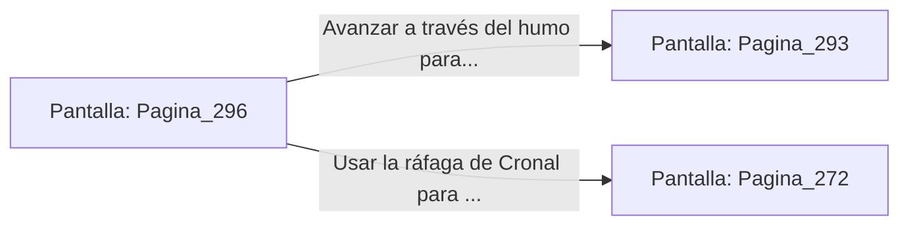

# 📺 Nodo Pantalla: `Pagina_296`

[[Index|⬅️ Índice]] | Fichero Origen: [[sample_eligejuego-code_capitulo_16_mpl|📄 sample/eligejuego-code/capitulo_16.mpl]]

**Narrativa y Encabezado:**
> PÁGINA 296: IMPACTO EN LA PEANA DEL TRONO
> 
> Tu granada de concusión impacta de lleno en los circuitos expuestos de la peana del trono. La explosión destruye el distribuidor principal de éter, cortando el suministro de energía de los centinelas y de los escudos de Malakor al mismo tiempo.
> 
> Envuelto en una nube de humo denso, el Inquisidor retrocede buscando cobertura tras la alfombra real.

## 📋 Desglose de Instrucciones de Opciones
### `OPCION "Avanzar a través del humo para extraer el Tercer Sello" CON_ACCION TRANSICIONAR_A Pagina_293`
* **Instrucción:** `OPCION` *(Manual: Mapea una entrada o botón interactivo de usuario. Vincular una acción como la invocación de una función C1, un método C2 o una transición C3.)*
* **Efecto de Control:** Dispara `TRANSICIONAR_A` hacia [[Pantalla_Pagina_293|📺 Pagina_293]]
### `OPCION "Usar la ráfaga de Cronal para derribarlo en el humo" CON_ACCION TRANSICIONAR_A Pagina_272`
* **Instrucción:** `OPCION` *(Manual: Mapea una entrada o botón interactivo de usuario. Vincular una acción como la invocación de una función C1, un método C2 o una transición C3.)*
* **Efecto de Control:** Dispara `TRANSICIONAR_A` hacia [[Pantalla_Pagina_272|📺 Pagina_272]]

## 📊 Diagrama de Flujo e Interacción (Mermaid)

