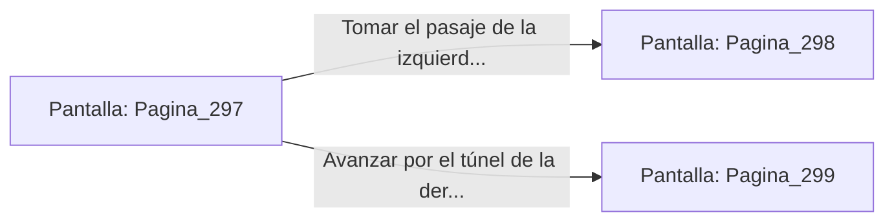

# 📺 Nodo Pantalla: `Pagina_297`

[[Index|⬅️ Índice]] | Fichero Origen: [[sample_eligejuego-code_capitulo_05_abismo_sombras_mpl|📄 sample/eligejuego-code/capitulo_05_abismo_sombras.mpl]]

**Narrativa y Encabezado:**
> Página 297: El Abismo de las Sombras
> 
> La oscuridad aquí es casi tangible. Tu báculo penas proyecta un tenue halo azulino. Te encuentras ante una encrucijada en la penumbra de la mazmorra. Debes tomar una decisión.

## 📋 Desglose de Instrucciones de Opciones
### `OPCION "Tomar el pasaje de la izquierda (Página 298)" CON_ACCION TRANSICIONAR_A Pagina_298`
* **Instrucción:** `OPCION` *(Manual: Mapea una entrada o botón interactivo de usuario. Vincular una acción como la invocación de una función C1, un método C2 o una transición C3.)*
* **Efecto de Control:** Dispara `TRANSICIONAR_A` hacia [[Pantalla_Pagina_298|📺 Pagina_298]]
### `OPCION "Avanzar por el túnel de la derecha (Página 299)" CON_ACCION TRANSICIONAR_A Pagina_299`
* **Instrucción:** `OPCION` *(Manual: Mapea una entrada o botón interactivo de usuario. Vincular una acción como la invocación de una función C1, un método C2 o una transición C3.)*
* **Efecto de Control:** Dispara `TRANSICIONAR_A` hacia [[Pantalla_Pagina_299|📺 Pagina_299]]

## 📊 Diagrama de Flujo e Interacción (Mermaid)

