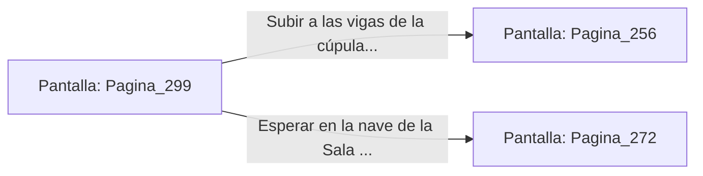

# 📺 Nodo Pantalla: `Pagina_299`

[[Index|⬅️ Índice]] | Fichero Origen: [[sample_eligejuego-code_capitulo_16_mpl|📄 sample/eligejuego-code/capitulo_16.mpl]]

**Narrativa y Encabezado:**
> PÁGINA 299: EL EMPUJE HACIA EL ABISMO
> 
> Pivotas sobre la estocada de Malakor y usas la fuerza de su propia embestida para guiarlo hacia el borde del balcón. La balaustrada cedente se quiebra y el Inquisidor cae hacia el vacío abisal.
> 
> Sin embargo, sus propulsores de emergencia se activan a escasos metros de la caída, permitiéndole elevarse de nuevo y aterrizar torpemente sobre las vigas de la cúpula con la armadura dañada.
> 
> Tienes la oportunidad de subir a la cúpula usando tu gancho o esperar a que vuelva a bajar a la nave principal.

## 📋 Desglose de Instrucciones de Opciones
### `OPCION "Subir a las vigas de la cúpula a rematar el combate" CON_ACCION TRANSICIONAR_A Pagina_256`
* **Instrucción:** `OPCION` *(Manual: Mapea una entrada o botón interactivo de usuario. Vincular una acción como la invocación de una función C1, un método C2 o una transición C3.)*
* **Efecto de Control:** Dispara `TRANSICIONAR_A` hacia [[Pantalla_Pagina_256|📺 Pagina_256]]
### `OPCION "Esperar en la nave de la Sala del Trono con el Rifle Cronal listo" CON_ACCION TRANSICIONAR_A Pagina_272`
* **Instrucción:** `OPCION` *(Manual: Mapea una entrada o botón interactivo de usuario. Vincular una acción como la invocación de una función C1, un método C2 o una transición C3.)*
* **Efecto de Control:** Dispara `TRANSICIONAR_A` hacia [[Pantalla_Pagina_272|📺 Pagina_272]]

## 📊 Diagrama de Flujo e Interacción (Mermaid)

