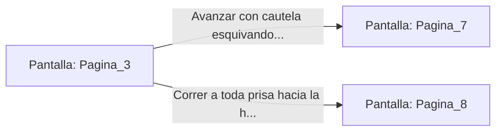

# 📺 Nodo Pantalla: `Pagina_3`

[[Index|⬅️ Índice]] | Fichero Origen: [[sample_eligejuego-code_capitulo_01_mpl|📄 sample/eligejuego-code/capitulo_01.mpl]]

**Narrativa y Encabezado:**
> PÁGINA 3: EL CORREDOR DEL FUEGO ALQUÍMICO
> 
> El calor golpea tu rostro como un puño de hierro en cuanto te adentras en el corredor. Las antorchas alquímicas dispuestas en las paredes de arenisca no consumen madera ni aceite; arden con un fuego azulado que no proyecta sombras, iluminando frescos olvidados que narran la caída del Imperio Crono.
> 
> Sientes que el ambiente está cargado de trampas mecánicas aún activas. Mientras caminas ajustándote al muro, notas que varias losas del suelo están ligeramente elevadas respecto al resto. Una corriente de aire frío procede de una hendidura al final del pasillo.

## 📋 Desglose de Instrucciones de Opciones
### `OPCION "Avanzar con cautela esquivando las losas elevadas" CON_ACCION TRANSICIONAR_A Pagina_7`
* **Instrucción:** `OPCION` *(Manual: Mapea una entrada o botón interactivo de usuario. Vincular una acción como la invocación de una función C1, un método C2 o una transición C3.)*
* **Efecto de Control:** Dispara `TRANSICIONAR_A` hacia [[Pantalla_Pagina_7|📺 Pagina_7]]
### `OPCION "Correr a toda prisa hacia la hendidura por donde entra aire frío" CON_ACCION TRANSICIONAR_A Pagina_8`
* **Instrucción:** `OPCION` *(Manual: Mapea una entrada o botón interactivo de usuario. Vincular una acción como la invocación de una función C1, un método C2 o una transición C3.)*
* **Efecto de Control:** Dispara `TRANSICIONAR_A` hacia [[Pantalla_Pagina_8|📺 Pagina_8]]

## 📊 Diagrama de Flujo e Interacción (Mermaid)

