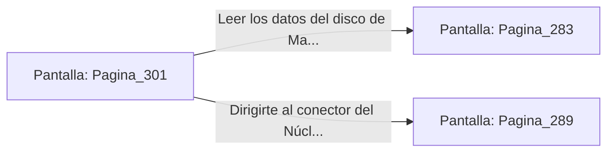

# 📺 Nodo Pantalla: `Pagina_301`

[[Index|⬅️ Índice]] | Fichero Origen: [[sample_eligejuego-code_capitulo_16_mpl|📄 sample/eligejuego-code/capitulo_16.mpl]]

**Narrativa y Encabezado:**
> PÁGINA 301: LA LA SINCRO TRIPLE DEL BRAZAL
> 
> Insertas el Tercer Sello de Fase en el último zócalo de tu Brazal de Convergencia. Un torrente de energía dorada y violeta recorre las líneas de tu interfaz, unificando los tres vectores de desestabilización en una única frecuencia armónica.
> 
> La pantalla de tu dispositivo confirma que la secuencia de Purga Cronal está lista para ser desplegada en la columna del Núcleo de Éter. Sin embargo, el disco de datos de Malakor parpadea en tu bolsillo táctico.
> 
> Debes elegir si leer los datos del disco de Malakor sobre el engaño de Vaelia o dirigirte directamente al conector del Núcleo.

## 📋 Desglose de Instrucciones de Opciones
### `OPCION "Leer los datos del disco de Malakor antes de activar la Purga" CON_ACCION TRANSICIONAR_A Pagina_283`
* **Instrucción:** `OPCION` *(Manual: Mapea una entrada o botón interactivo de usuario. Vincular una acción como la invocación de una función C1, un método C2 o una transición C3.)*
* **Efecto de Control:** Dispara `TRANSICIONAR_A` hacia [[Pantalla_Pagina_283|📺 Pagina_283]]
### `OPCION "Dirigirte al conector del Núcleo de Éter para ejecutar la Purga" CON_ACCION TRANSICIONAR_A Pagina_289`
* **Instrucción:** `OPCION` *(Manual: Mapea una entrada o botón interactivo de usuario. Vincular una acción como la invocación de una función C1, un método C2 o una transición C3.)*
* **Efecto de Control:** Dispara `TRANSICIONAR_A` hacia [[Pantalla_Pagina_289|📺 Pagina_289]]

## 📊 Diagrama de Flujo e Interacción (Mermaid)

