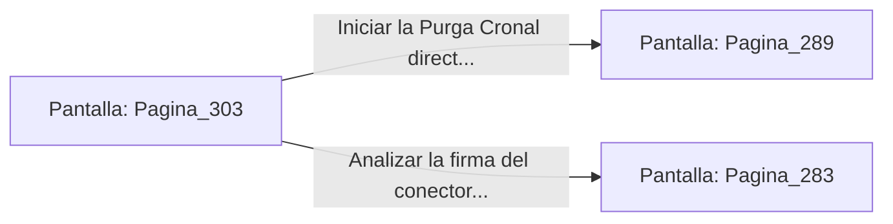

# 📺 Nodo Pantalla: `Pagina_303`

[[Index|⬅️ Índice]] | Fichero Origen: [[sample_eligejuego-code_capitulo_16_mpl|📄 sample/eligejuego-code/capitulo_16.mpl]]

**Narrativa y Encabezado:**
> PÁGINA 303: EL ALTAR DEL NÚCLEO DE ÉTER
> 
> Te aproximas a la columna de plasma del Núcleo de Éter en el centro de la nave. El campo de fuerza vibra con una intensidad cegadora que hace flotar los fragmentos de piedra a tu alrededor.
> 
> Sujetas tu Brazal de Convergencia frente al conector principal. La interfaz te solicita confirmar el inicio de la secuencia de Purga Cronal para estabilizar las 600 Cámaras de Aethelgard.
> 
> Puedes iniciar la Purga directamente o analizar la firma de datos del conector con la información del disco de Malakor.

## 📋 Desglose de Instrucciones de Opciones
### `OPCION "Iniciar la Purga Cronal directamente en el conector del Núcleo" CON_ACCION TRANSICIONAR_A Pagina_289`
* **Instrucción:** `OPCION` *(Manual: Mapea una entrada o botón interactivo de usuario. Vincular una acción como la invocación de una función C1, un método C2 o una transición C3.)*
* **Efecto de Control:** Dispara `TRANSICIONAR_A` hacia [[Pantalla_Pagina_289|📺 Pagina_289]]
### `OPCION "Analizar la firma del conector con los datos del disco de Malakor" CON_ACCION TRANSICIONAR_A Pagina_283`
* **Instrucción:** `OPCION` *(Manual: Mapea una entrada o botón interactivo de usuario. Vincular una acción como la invocación de una función C1, un método C2 o una transición C3.)*
* **Efecto de Control:** Dispara `TRANSICIONAR_A` hacia [[Pantalla_Pagina_283|📺 Pagina_283]]

## 📊 Diagrama de Flujo e Interacción (Mermaid)

