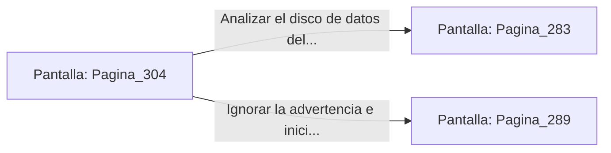

# 📺 Nodo Pantalla: `Pagina_304`

[[Index|⬅️ Índice]] | Fichero Origen: [[sample_eligejuego-code_capitulo_16_mpl|📄 sample/eligejuego-code/capitulo_16.mpl]]

**Narrativa y Encabezado:**
> PÁGINA 304: REVELACIONES EN EL LECHO DE MUERTE
> 
> Te inclinas sobre Malakor desarmado. Con su último aliento, el viejo Archimago te advierte sobre la verdadera identidad de la Archivista Vaelia y te entrega el disco codificado del Código Cero.
> 
> Con la verdad en tu conocimiento y el disco en tus manos, te incorporas frente al conector del Núcleo.

## 📋 Desglose de Instrucciones de Opciones
### `OPCION "Analizar el disco de datos del Código Cero" CON_ACCION TRANSICIONAR_A Pagina_283`
* **Instrucción:** `OPCION` *(Manual: Mapea una entrada o botón interactivo de usuario. Vincular una acción como la invocación de una función C1, un método C2 o una transición C3.)*
* **Efecto de Control:** Dispara `TRANSICIONAR_A` hacia [[Pantalla_Pagina_283|📺 Pagina_283]]
### `OPCION "Ignorar la advertencia e iniciar la Purga directamente" CON_ACCION TRANSICIONAR_A Pagina_289`
* **Instrucción:** `OPCION` *(Manual: Mapea una entrada o botón interactivo de usuario. Vincular una acción como la invocación de una función C1, un método C2 o una transición C3.)*
* **Efecto de Control:** Dispara `TRANSICIONAR_A` hacia [[Pantalla_Pagina_289|📺 Pagina_289]]

## 📊 Diagrama de Flujo e Interacción (Mermaid)

