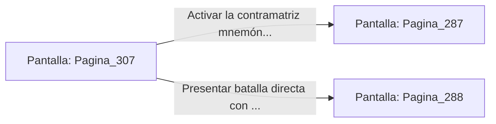

# 📺 Nodo Pantalla: `Pagina_307`

[[Index|⬅️ Índice]] | Fichero Origen: [[sample_eligejuego-code_capitulo_16_mpl|📄 sample/eligejuego-code/capitulo_16.mpl]]

**Narrativa y Encabezado:**
> PÁGINA 307: LA CONTRAMATRIZ QUÁNTICA
> 
> Utilizas los mandos de tu Brazal de Convergencia para alterar la secuencia de la Purga Cronal, transformando la descarga de energía en una trampa de contención mnemónica de alta densidad.
> 
> Con la contramatriz lista, te adentras en la Antesala del Núcleo Cero. La forma astral de Vaelia se aproxima flotando sobre la plataforma, extendiendo sus manos para exigir la entrega del dispositivo.
> 
> Tienes la opción de activar la contramatriz para sellar la esencia de Vaelia en un cristal o presentar batalla con el Rifle Cronal.

## 📋 Desglose de Instrucciones de Opciones
### `OPCION "Activar la contramatriz mnemónica para sellar a Vaelia" CON_ACCION TRANSICIONAR_A Pagina_287`
* **Instrucción:** `OPCION` *(Manual: Mapea una entrada o botón interactivo de usuario. Vincular una acción como la invocación de una función C1, un método C2 o una transición C3.)*
* **Efecto de Control:** Dispara `TRANSICIONAR_A` hacia [[Pantalla_Pagina_287|📺 Pagina_287]]
### `OPCION "Presentar batalla directa con el Rifle Cronal contra Vaelia" CON_ACCION TRANSICIONAR_A Pagina_288`
* **Instrucción:** `OPCION` *(Manual: Mapea una entrada o botón interactivo de usuario. Vincular una acción como la invocación de una función C1, un método C2 o una transición C3.)*
* **Efecto de Control:** Dispara `TRANSICIONAR_A` hacia [[Pantalla_Pagina_288|📺 Pagina_288]]

## 📊 Diagrama de Flujo e Interacción (Mermaid)

