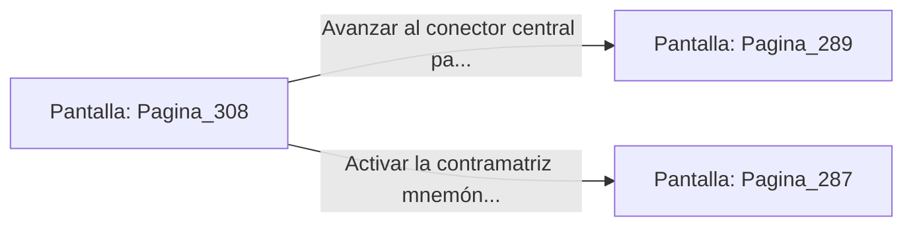

# 📺 Nodo Pantalla: `Pagina_308`

[[Index|⬅️ Índice]] | Fichero Origen: [[sample_eligejuego-code_capitulo_16_mpl|📄 sample/eligejuego-code/capitulo_16.mpl]]

**Narrativa y Encabezado:**
> PÁGINA 308: DUELO CONTRA VAELIA ASTRAL
> 
> Despliegas tu Escudo Deflector para interceptar los haces de luz estelar de Vaelia. El campo cuántico refleja las descargas de vuelta contra la forma astral de la entidad, agrietando su manifestación de éter.
> 
> Aturdida por el impacto reflejado, Vaelia pierde el control del campo de fuerza del conector central.

## 📋 Desglose de Instrucciones de Opciones
### `OPCION "Avanzar al conector central para ejecutar la estabilización" CON_ACCION TRANSICIONAR_A Pagina_289`
* **Instrucción:** `OPCION` *(Manual: Mapea una entrada o botón interactivo de usuario. Vincular una acción como la invocación de una función C1, un método C2 o una transición C3.)*
* **Efecto de Control:** Dispara `TRANSICIONAR_A` hacia [[Pantalla_Pagina_289|📺 Pagina_289]]
### `OPCION "Activar la contramatriz mnemónica para sellar su esencia" CON_ACCION TRANSICIONAR_A Pagina_287`
* **Instrucción:** `OPCION` *(Manual: Mapea una entrada o botón interactivo de usuario. Vincular una acción como la invocación de una función C1, un método C2 o una transición C3.)*
* **Efecto de Control:** Dispara `TRANSICIONAR_A` hacia [[Pantalla_Pagina_287|📺 Pagina_287]]

## 📊 Diagrama de Flujo e Interacción (Mermaid)

