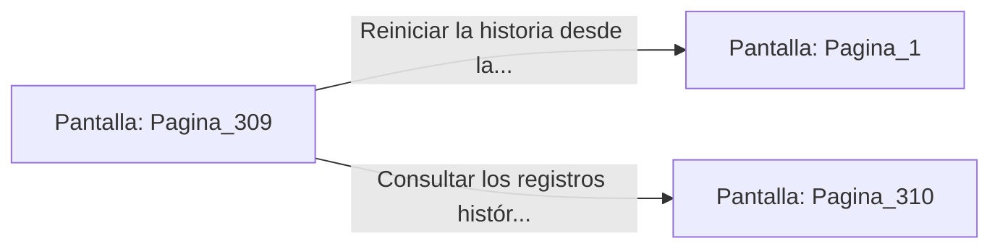

# 📺 Nodo Pantalla: `Pagina_309`

[[Index|⬅️ Índice]] | Fichero Origen: [[sample_eligejuego-code_capitulo_16_mpl|📄 sample/eligejuego-code/capitulo_16.mpl]]

**Narrativa y Encabezado:**
> PÁGINA 309: EL RENACER DE AETHELGARD
> 
> Accionas el mando maestro de la consola del Núcleo. La descarga de energía dorada de los tres sellos penetra en la columna de plasma, sellando para siempre las fisuras del espacio-tiempo en las 600 Cámaras.
> 
> El zumbido del Cronoclave se transforma en una sinfonía de luz pacífica. Las ruinas de la ciudadela subterránea comienzan a iluminarse con el resplandor de la restauración temporal.
> 
> Has triunfado sobre Malakor y el engaño de Vaelia, asegurando la existencia de todas las líneas temporales. Tu leyenda vivirá para siempre en Aethelgard.

## 📋 Desglose de Instrucciones de Opciones
### `OPCION "Reiniciar la historia desde la Página 1" CON_ACCION TRANSICIONAR_A Pagina_1`
* **Instrucción:** `OPCION` *(Manual: Mapea una entrada o botón interactivo de usuario. Vincular una acción como la invocación de una función C1, un método C2 o una transición C3.)*
* **Efecto de Control:** Dispara `TRANSICIONAR_A` hacia [[Pantalla_Pagina_1|📺 Pagina_1]]
### `OPCION "Consultar los registros históricos finales de las 600 Cámaras" CON_ACCION TRANSICIONAR_A Pagina_310`
* **Instrucción:** `OPCION` *(Manual: Mapea una entrada o botón interactivo de usuario. Vincular una acción como la invocación de una función C1, un método C2 o una transición C3.)*
* **Efecto de Control:** Dispara `TRANSICIONAR_A` hacia [[Pantalla_Pagina_310|📺 Pagina_310]]

## 📊 Diagrama de Flujo e Interacción (Mermaid)

