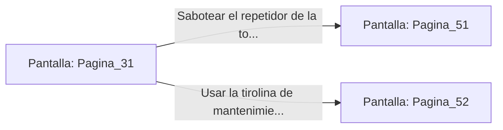

# 📺 Nodo Pantalla: `Pagina_31`

[[Index|⬅️ Índice]] | Fichero Origen: [[sample_eligejuego-code_capitulo_03_mpl|📄 sample/eligejuego-code/capitulo_03.mpl]]

**Narrativa y Encabezado:**
> PÁGINA 31: INTERCEPCIÓN EN LA TORRE
> 
> Ajustas la rueda de sintonía del receptor de radio arcana. Entre el estático y los chasquidos electromagnéticos, una voz distorsionada y metálica resuena en los altavoces de la consola: es el mismísimo Inquisidor Malakor ordenando el despliegue inmediato de la Legión de Sombras en el sector de los Jardines Sintéticos.
> 
> Escuchas atentamente los códigos de encriptación dictados en la transmisión. Tu Brazal de Convergencia memoriza las claves de frecuencia militar, lo que te permitirá hackear las puertas acorazadas del sector central sin llamar la atención de las torretas automáticas.
> 
> Con la información en tu poder, debes decidir tu siguiente movimiento: sabotear el repetidor principal de la torre para cortar las comunicaciones enemigas o usar la tirolina de mantenimiento para descender directamente al patio central.

## 📋 Desglose de Instrucciones de Opciones
### `OPCION "Sabotear el repetidor de la torre para aislar a la Legión" CON_ACCION TRANSICIONAR_A Pagina_51`
* **Instrucción:** `OPCION` *(Manual: Mapea una entrada o botón interactivo de usuario. Vincular una acción como la invocación de una función C1, un método C2 o una transición C3.)*
* **Efecto de Control:** Dispara `TRANSICIONAR_A` hacia [[Pantalla_Pagina_51|📺 Pagina_51]]
### `OPCION "Usar la tirolina de mantenimiento para bajar al Patio Central" CON_ACCION TRANSICIONAR_A Pagina_52`
* **Instrucción:** `OPCION` *(Manual: Mapea una entrada o botón interactivo de usuario. Vincular una acción como la invocación de una función C1, un método C2 o una transición C3.)*
* **Efecto de Control:** Dispara `TRANSICIONAR_A` hacia [[Pantalla_Pagina_52|📺 Pagina_52]]

## 📊 Diagrama de Flujo e Interacción (Mermaid)

