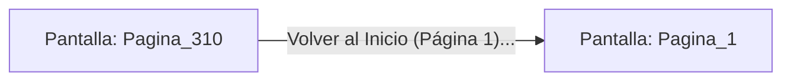

# 📺 Nodo Pantalla: `Pagina_310`

[[Index|⬅️ Índice]] | Fichero Origen: [[sample_eligejuego-code_capitulo_16_mpl|📄 sample/eligejuego-code/capitulo_16.mpl]]

**Narrativa y Encabezado:**
> PÁGINA 310: REGISTROS FINALES DE LA CIUDADELA
> 
> Los archivos de Mnemósine quedan grabados en la memoria de tu Brazal de Convergencia, documentando tu victoria a través de los nodos y cámaras del Cronoclave de las Sombras.

## 📋 Desglose de Instrucciones de Opciones
### `OPCION "Volver al Inicio (Página 1)" CON_ACCION TRANSICIONAR_A Pagina_1`
* **Instrucción:** `OPCION` *(Manual: Mapea una entrada o botón interactivo de usuario. Vincular una acción como la invocación de una función C1, un método C2 o una transición C3.)*
* **Efecto de Control:** Dispara `TRANSICIONAR_A` hacia [[Pantalla_Pagina_1|📺 Pagina_1]]

## 📊 Diagrama de Flujo e Interacción (Mermaid)

