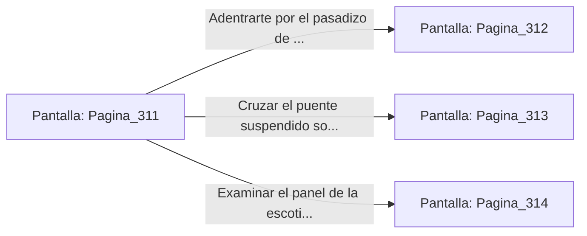

# 📺 Nodo Pantalla: `Pagina_311`

[[Index|⬅️ Índice]] | Fichero Origen: [[sample_eligejuego-code_capitulo_17_mpl|📄 sample/eligejuego-code/capitulo_17.mpl]]

**Narrativa y Encabezado:**
> PÁGINA 311: EL UMBRAL DE LA SEGUNDA CONVERGENCIA
> 
> Al cruzar el umbral tras la caída de la forma astral de Vaelia, una resonancia armónica sacude las paredes de basalto. Las placas de la arquitectura ancestral comienzan a desplazarse con estrépito, reordenando las salas en un laberinto dinámico de geometría no euclidiana que se expande hacia las profundidades del Sector Subterráneo Medio.
> 
> Tu Brazal de Convergencia emite un chasquido de advertencia: aunque el Núcleo Cero ha sido asegurado, los subsistemas secundarios de las Cámaras 311 a 330 han entrado en un bucle de seguridad automatizado. Unidades de centinelas pesados de la Vieja Guardia caminan entre las brumas de éter purificado, buscando erradicar cualquier entidad que no posea la firma de los Antiguos.
> 
> Frente a ti se extienden tres rutas recién desplegadas por el cambio de las losas: un pasadizo flanqueado por columnas de magma contenido, un puente suspendido sobre depósitos de azufre y una escotilla neumática rúnica.

## 📋 Desglose de Instrucciones de Opciones
### `OPCION "Adentrarte por el pasadizo de las columnas de magma contenido" CON_ACCION TRANSICIONAR_A Pagina_312`
* **Instrucción:** `OPCION` *(Manual: Mapea una entrada o botón interactivo de usuario. Vincular una acción como la invocación de una función C1, un método C2 o una transición C3.)*
* **Efecto de Control:** Dispara `TRANSICIONAR_A` hacia [[Pantalla_Pagina_312|📺 Pagina_312]]
### `OPCION "Cruzar el puente suspendido sobre los depósitos de azufre" CON_ACCION TRANSICIONAR_A Pagina_313`
* **Instrucción:** `OPCION` *(Manual: Mapea una entrada o botón interactivo de usuario. Vincular una acción como la invocación de una función C1, un método C2 o una transición C3.)*
* **Efecto de Control:** Dispara `TRANSICIONAR_A` hacia [[Pantalla_Pagina_313|📺 Pagina_313]]
### `OPCION "Examinar el panel de la escotilla neumática rúnica" CON_ACCION TRANSICIONAR_A Pagina_314`
* **Instrucción:** `OPCION` *(Manual: Mapea una entrada o botón interactivo de usuario. Vincular una acción como la invocación de una función C1, un método C2 o una transición C3.)*
* **Efecto de Control:** Dispara `TRANSICIONAR_A` hacia [[Pantalla_Pagina_314|📺 Pagina_314]]

## 📊 Diagrama de Flujo e Interacción (Mermaid)

