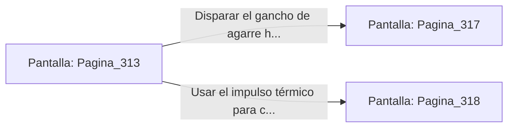

# 📺 Nodo Pantalla: `Pagina_313`

[[Index|⬅️ Índice]] | Fichero Origen: [[sample_eligejuego-code_capitulo_17_mpl|📄 sample/eligejuego-code/capitulo_17.mpl]]

**Narrativa y Encabezado:**
> PÁGINA 313: EL PUENTE DE AZUFRE
> 
> Te adentras por el tembloroso puente de aleación pesada que cruza los pozos de azufre hirviente. Vapores amarillentos y densos ascienden desde el abismo, mermando drásticamente tu visibilidad y obligando al sistema de filtrado de tu Brazal a trabajar a pleno rendimiento.
> 
> A mitad de la travesía, las cadenas de sujeción de la izquierda ceden por la corrosión ácida, provocando que la pasarela se incline peligrosamente sobre el pozo de fuego sulfúrico. Debes reaccionar en una fracción de segundo para no despeñarte.
> 
> Tienes la opción de disparar tu gancho de agarre hacia las vigas del techo para cruzar volando o usar tu impulso térmico para correr por la cornisa de piedra adyacente.

## 📋 Desglose de Instrucciones de Opciones
### `OPCION "Disparar el gancho de agarre hacia las vigas del techo" CON_ACCION TRANSICIONAR_A Pagina_317`
* **Instrucción:** `OPCION` *(Manual: Mapea una entrada o botón interactivo de usuario. Vincular una acción como la invocación de una función C1, un método C2 o una transición C3.)*
* **Efecto de Control:** Dispara `TRANSICIONAR_A` hacia [[Pantalla_Pagina_317|📺 Pagina_317]]
### `OPCION "Usar el impulso térmico para correr por la cornisa adyacente" CON_ACCION TRANSICIONAR_A Pagina_318`
* **Instrucción:** `OPCION` *(Manual: Mapea una entrada o botón interactivo de usuario. Vincular una acción como la invocación de una función C1, un método C2 o una transición C3.)*
* **Efecto de Control:** Dispara `TRANSICIONAR_A` hacia [[Pantalla_Pagina_318|📺 Pagina_318]]

## 📊 Diagrama de Flujo e Interacción (Mermaid)

