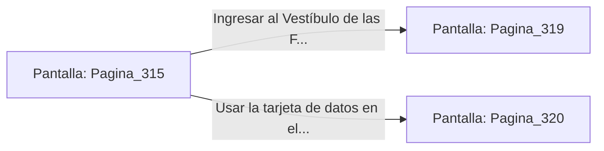

# 📺 Nodo Pantalla: `Pagina_315`

[[Index|⬅️ Índice]] | Fichero Origen: [[sample_eligejuego-code_capitulo_17_mpl|📄 sample/eligejuego-code/capitulo_17.mpl]]

**Narrativa y Encabezado:**
> PÁGINA 315: PURGA DE PLASMA MAGMÁTICO
> 
> Giras la rueda de la válvula de derivación con ayuda del servo de tu Brazal. Un chorro de vapor de plasma a alta presión sale disparado contra la barricada de mineros, fundiendo las aleaciones de titanio y despejando el camino en cuestión de segundos.
> 
> El calor liberado derrite parcialmente las placas del techo, revelando un nicho acorazado que ocultaba un Cofre de los Primeros Forjadores. En su interior reposa una Célula de Éter Sobrecargada y una tarjeta de datos de la Bóveda de Alquimia.
> 
> Con las reliquias en tu inventario, cruzas la brecha derretida hacia el Vestíbulo de las Forjas Profundas.

## 📋 Desglose de Instrucciones de Opciones
### `OPCION "Ingresar al Vestíbulo de las Forjas Profundas" CON_ACCION TRANSICIONAR_A Pagina_319`
* **Instrucción:** `OPCION` *(Manual: Mapea una entrada o botón interactivo de usuario. Vincular una acción como la invocación de una función C1, un método C2 o una transición C3.)*
* **Efecto de Control:** Dispara `TRANSICIONAR_A` hacia [[Pantalla_Pagina_319|📺 Pagina_319]]
### `OPCION "Usar la tarjeta de datos en el terminal lateral de alquimia" CON_ACCION TRANSICIONAR_A Pagina_320`
* **Instrucción:** `OPCION` *(Manual: Mapea una entrada o botón interactivo de usuario. Vincular una acción como la invocación de una función C1, un método C2 o una transición C3.)*
* **Efecto de Control:** Dispara `TRANSICIONAR_A` hacia [[Pantalla_Pagina_320|📺 Pagina_320]]

## 📊 Diagrama de Flujo e Interacción (Mermaid)

