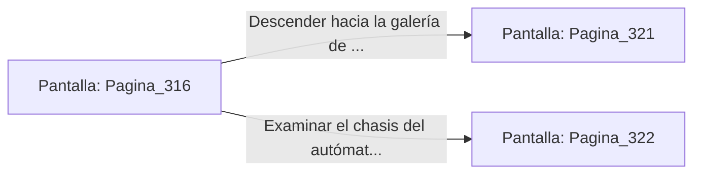

# 📺 Nodo Pantalla: `Pagina_316`

[[Index|⬅️ Índice]] | Fichero Origen: [[sample_eligejuego-code_capitulo_17_mpl|📄 sample/eligejuego-code/capitulo_17.mpl]]

**Narrativa y Encabezado:**
> PÁGINA 316: LA ESCALADA SOBRE LA BARRICADA
> 
> Trepas sobre los restos apilados de los autómatas mineros. La estructura de metal chatarra rechina bajo tus botas, pero logras coronar la cima de la barricada sin activar los sensores de peso que permanecían durmientes.
> 
> Al otro lado se abre una galería abovedada iluminada por la luz bioluminiscente de los tanques de cultivo mineral.

## 📋 Desglose de Instrucciones de Opciones
### `OPCION "Descender hacia la galería de los tanques de cultivo mineral" CON_ACCION TRANSICIONAR_A Pagina_321`
* **Instrucción:** `OPCION` *(Manual: Mapea una entrada o botón interactivo de usuario. Vincular una acción como la invocación de una función C1, un método C2 o una transición C3.)*
* **Efecto de Control:** Dispara `TRANSICIONAR_A` hacia [[Pantalla_Pagina_321|📺 Pagina_321]]
### `OPCION "Examinar el chasis del autómata líder de la barricada" CON_ACCION TRANSICIONAR_A Pagina_322`
* **Instrucción:** `OPCION` *(Manual: Mapea una entrada o botón interactivo de usuario. Vincular una acción como la invocación de una función C1, un método C2 o una transición C3.)*
* **Efecto de Control:** Dispara `TRANSICIONAR_A` hacia [[Pantalla_Pagina_322|📺 Pagina_322]]

## 📊 Diagrama de Flujo e Interacción (Mermaid)

