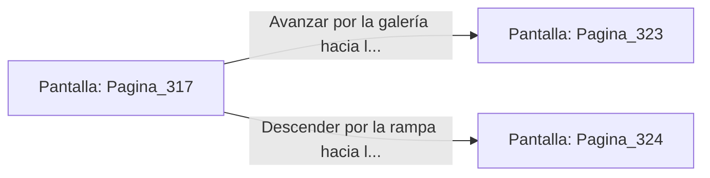

# 📺 Nodo Pantalla: `Pagina_317`

[[Index|⬅️ Índice]] | Fichero Origen: [[sample_eligejuego-code_capitulo_17_mpl|📄 sample/eligejuego-code/capitulo_17.mpl]]

**Narrativa y Encabezado:**
> PÁGINA 317: EL VUELO SOBRE EL AZUFRE
> 
> Disparas el gancho de agarre de titanio con precisión milimétrica hacia la viga de soporte de la bóveda. El ancla se clava con firmeza justo cuando la sección del puente se colapsa y cae al pozo hirviente de azufre.
> 
> Balanceándote sobre el vacío, describes un arco en el aire y te sueltas de la cuerda en el momento óptimo, aterrizando de pie sobre la plataforma fija del extremo opuesto de la caverna.
> 
> Desde esta nueva posición divisas dos vías: la galería de acceso a los Talleres del Cristal y una rampa de piedra que desciende hacia los depósitos de escoria.

## 📋 Desglose de Instrucciones de Opciones
### `OPCION "Avanzar por la galería hacia los Talleres del Cristal" CON_ACCION TRANSICIONAR_A Pagina_323`
* **Instrucción:** `OPCION` *(Manual: Mapea una entrada o botón interactivo de usuario. Vincular una acción como la invocación de una función C1, un método C2 o una transición C3.)*
* **Efecto de Control:** Dispara `TRANSICIONAR_A` hacia [[Pantalla_Pagina_323|📺 Pagina_323]]
### `OPCION "Descender por la rampa hacia los depósitos de escoria" CON_ACCION TRANSICIONAR_A Pagina_324`
* **Instrucción:** `OPCION` *(Manual: Mapea una entrada o botón interactivo de usuario. Vincular una acción como la invocación de una función C1, un método C2 o una transición C3.)*
* **Efecto de Control:** Dispara `TRANSICIONAR_A` hacia [[Pantalla_Pagina_324|📺 Pagina_324]]

## 📊 Diagrama de Flujo e Interacción (Mermaid)

