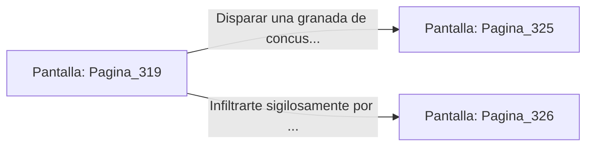

# 📺 Nodo Pantalla: `Pagina_319`

[[Index|⬅️ Índice]] | Fichero Origen: [[sample_eligejuego-code_capitulo_17_mpl|📄 sample/eligejuego-code/capitulo_17.mpl]]

**Narrativa y Encabezado:**
> PÁGINA 319: EL VESTÍBULO DE LAS FORJAS PROFUNDAS
> 
> Penetras en la monumental nave de las Forjas Profundas. Martillos neumático gigantescos movidos por la energía del éter caen sobre yunque de titanio, generando un ritmo atronador que sacude el polvo de las vigas abovedadas.
> 
> En el centro de la fábrica, un contingente de tres centinelas mecánicos de la Vieja Guardia patrulla la pasarela de control empuñando alabardas de plasma térmico. No te han detectado todavía gracias a la densa nube de chispas.
> 
> Puedes usar el lanzagranadas de concusión para destruir la estructura de la pasarela y hacer caer a los centinelas o infiltrarte por el foso inferior de ventilación.

## 📋 Desglose de Instrucciones de Opciones
### `OPCION "Disparar una granada de concusión contra la pasarela de control" CON_ACCION TRANSICIONAR_A Pagina_325`
* **Instrucción:** `OPCION` *(Manual: Mapea una entrada o botón interactivo de usuario. Vincular una acción como la invocación de una función C1, un método C2 o una transición C3.)*
* **Efecto de Control:** Dispara `TRANSICIONAR_A` hacia [[Pantalla_Pagina_325|📺 Pagina_325]]
### `OPCION "Infiltrarte sigilosamente por el foso inferior de ventilación" CON_ACCION TRANSICIONAR_A Pagina_326`
* **Instrucción:** `OPCION` *(Manual: Mapea una entrada o botón interactivo de usuario. Vincular una acción como la invocación de una función C1, un método C2 o una transición C3.)*
* **Efecto de Control:** Dispara `TRANSICIONAR_A` hacia [[Pantalla_Pagina_326|📺 Pagina_326]]

## 📊 Diagrama de Flujo e Interacción (Mermaid)

