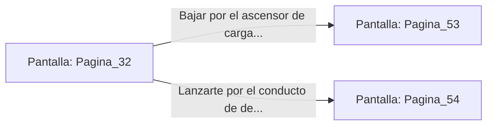

# 📺 Nodo Pantalla: `Pagina_32`

[[Index|⬅️ Índice]] | Fichero Origen: [[sample_eligejuego-code_capitulo_03_mpl|📄 sample/eligejuego-code/capitulo_03.mpl]]

**Narrativa y Encabezado:**
> PÁGINA 32: REFLECTORES EN LA NOCHE
> 
> Accionas la palanca principal y los potentes proyectores de éter de la torre se encienden, proyectando ases de luz cegadora sobre el patio inferior. Abajo, los centinelas de Malakor quedan desorientados, tapándose los visores mientras cunde el caos entre sus filas.
> 
> Aprovechando la confusión creada, buscas la vía de bajada más rápida antes de que las unidades pesadas disparen contra la cúpula de la torre.

## 📋 Desglose de Instrucciones de Opciones
### `OPCION "Bajar por el ascensor de carga de la torre" CON_ACCION TRANSICIONAR_A Pagina_53`
* **Instrucción:** `OPCION` *(Manual: Mapea una entrada o botón interactivo de usuario. Vincular una acción como la invocación de una función C1, un método C2 o una transición C3.)*
* **Efecto de Control:** Dispara `TRANSICIONAR_A` hacia [[Pantalla_Pagina_53|📺 Pagina_53]]
### `OPCION "Lanzarte por el conducto de desecho con el paracaídas energético" CON_ACCION TRANSICIONAR_A Pagina_54`
* **Instrucción:** `OPCION` *(Manual: Mapea una entrada o botón interactivo de usuario. Vincular una acción como la invocación de una función C1, un método C2 o una transición C3.)*
* **Efecto de Control:** Dispara `TRANSICIONAR_A` hacia [[Pantalla_Pagina_54|📺 Pagina_54]]

## 📊 Diagrama de Flujo e Interacción (Mermaid)

