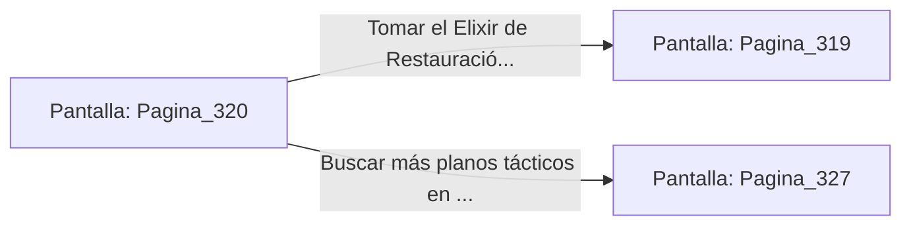

# 📺 Nodo Pantalla: `Pagina_320`

[[Index|⬅️ Índice]] | Fichero Origen: [[sample_eligejuego-code_capitulo_17_mpl|📄 sample/eligejuego-code/capitulo_17.mpl]]

**Narrativa y Encabezado:**
> PÁGINA 320: BÓVEDA DE ALQUIMIA SECUNDARIA
> 
> Insertas la tarjeta de datos en el terminal de la bóveda. Las compuertas blindadas de teca y bronce se abren revelando una estación de destilación alquímica intacta desde la época de los Antiguos Sabios.
> 
> Sintetizas un Vial de Elixir de Restauración que recarga instantáneamente la salud de tu Brazal y aumenta la potencia de tus proyectiles.

## 📋 Desglose de Instrucciones de Opciones
### `OPCION "Tomar el Elixir de Restauración e ir a las Forjas Profundas" CON_ACCION TRANSICIONAR_A Pagina_319`
* **Instrucción:** `OPCION` *(Manual: Mapea una entrada o botón interactivo de usuario. Vincular una acción como la invocación de una función C1, un método C2 o una transición C3.)*
* **Efecto de Control:** Dispara `TRANSICIONAR_A` hacia [[Pantalla_Pagina_319|📺 Pagina_319]]
### `OPCION "Buscar más planos tácticos en los anaqueles de la bóveda" CON_ACCION TRANSICIONAR_A Pagina_327`
* **Instrucción:** `OPCION` *(Manual: Mapea una entrada o botón interactivo de usuario. Vincular una acción como la invocación de una función C1, un método C2 o una transición C3.)*
* **Efecto de Control:** Dispara `TRANSICIONAR_A` hacia [[Pantalla_Pagina_327|📺 Pagina_327]]

## 📊 Diagrama de Flujo e Interacción (Mermaid)

