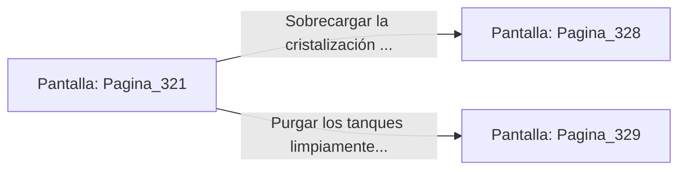

# 📺 Nodo Pantalla: `Pagina_321`

[[Index|⬅️ Índice]] | Fichero Origen: [[sample_eligejuego-code_capitulo_17_mpl|📄 sample/eligejuego-code/capitulo_17.mpl]]

**Narrativa y Encabezado:**
> PÁGINA 321: LOS TANQUES DE CULTIVO MINERAL
> 
> Avanzas entre filas de tanques cilíndricos de cuarzo llenos de un líquido azulino resplandeciente en el que crecen cristales de energía sintéticos. La luz bioluminiscente baña la estancia con tonos esmeralda y violeta.
> 
> En la consola de calibración central se ofrece la opción de sobrecargar la cristalización para extraer una gema de combate o purgar los tanques para despejar la ruta de drenaje.
> 
> Extraer la gema aumentará la potencia de tus armas, pero el ruido de la sobrecarga podría atraer a las patrullas del sector colindante.

## 📋 Desglose de Instrucciones de Opciones
### `OPCION "Sobrecargar la cristalización para extraer una Gema de Combate" CON_ACCION TRANSICIONAR_A Pagina_328`
* **Instrucción:** `OPCION` *(Manual: Mapea una entrada o botón interactivo de usuario. Vincular una acción como la invocación de una función C1, un método C2 o una transición C3.)*
* **Efecto de Control:** Dispara `TRANSICIONAR_A` hacia [[Pantalla_Pagina_328|📺 Pagina_328]]
### `OPCION "Purgar los tanques limpiamente para usar la ruta de drenaje" CON_ACCION TRANSICIONAR_A Pagina_329`
* **Instrucción:** `OPCION` *(Manual: Mapea una entrada o botón interactivo de usuario. Vincular una acción como la invocación de una función C1, un método C2 o una transición C3.)*
* **Efecto de Control:** Dispara `TRANSICIONAR_A` hacia [[Pantalla_Pagina_329|📺 Pagina_329]]

## 📊 Diagrama de Flujo e Interacción (Mermaid)

