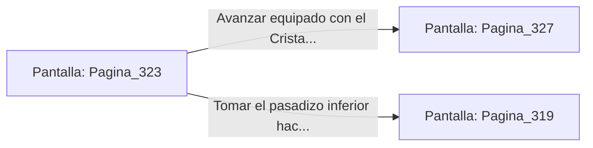

# 📺 Nodo Pantalla: `Pagina_323`

[[Index|⬅️ Índice]] | Fichero Origen: [[sample_eligejuego-code_capitulo_17_mpl|📄 sample/eligejuego-code/capitulo_17.mpl]]

**Narrativa y Encabezado:**
> PÁGINA 323: LOS TALLERES DEL CRISTAL
> 
> Llegas a los Talleres del Cristal, donde los artesanos de Aethelgard pulían los lentes de los telescopios estelares. Herramientas de corte diamantadas y bancos de trabajo de piedra negra se extienden en orden impecable.
> 
> Sobre un pedestal central flota un Cristal de Enfoque Puro de tres caras que vibra al unísono con la frecuencia de tu Brazal. Al adosarlo a tu visor, tu capacidad de detección de trampas aumenta exponencialmente.
> 
> Con la mejora integrada en tu casco, buscas la puerta de salida hacia el Laboratorio de Inducción o hacia la Fosa de los Autómatas.

## 📋 Desglose de Instrucciones de Opciones
### `OPCION "Avanzar equipado con el Cristal de Enfoque hacia el Laboratorio de Inducción" CON_ACCION TRANSICIONAR_A Pagina_327`
* **Instrucción:** `OPCION` *(Manual: Mapea una entrada o botón interactivo de usuario. Vincular una acción como la invocación de una función C1, un método C2 o una transición C3.)*
* **Efecto de Control:** Dispara `TRANSICIONAR_A` hacia [[Pantalla_Pagina_327|📺 Pagina_327]]
### `OPCION "Tomar el pasadizo inferior hacia la Fosa de los Autómatas" CON_ACCION TRANSICIONAR_A Pagina_319`
* **Instrucción:** `OPCION` *(Manual: Mapea una entrada o botón interactivo de usuario. Vincular una acción como la invocación de una función C1, un método C2 o una transición C3.)*
* **Efecto de Control:** Dispara `TRANSICIONAR_A` hacia [[Pantalla_Pagina_319|📺 Pagina_319]]

## 📊 Diagrama de Flujo e Interacción (Mermaid)

