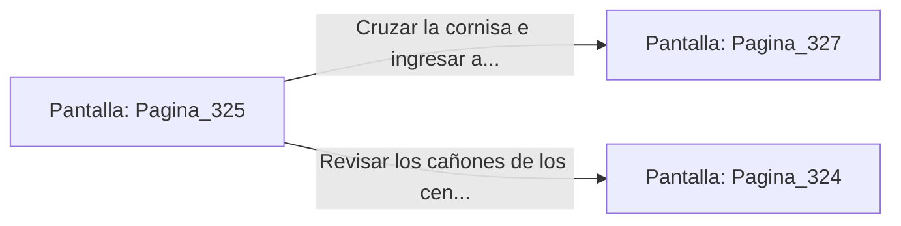

# 📺 Nodo Pantalla: `Pagina_325`

[[Index|⬅️ Índice]] | Fichero Origen: [[sample_eligejuego-code_capitulo_17_mpl|📄 sample/eligejuego-code/capitulo_17.mpl]]

**Narrativa y Encabezado:**
> PÁGINA 325: DESTRUCCIÓN DE LA PASARELA DE CONTROL
> 
> Disparas tu granada de concusión contra la viga maestra de la pasarela de control. La onda expansiva quiebra el metal corroído y la estructura colapsa, despeñando a los tres centinelas pesados al fondo de las forjas.
> 
> El estruendo del colapso resuena en toda la nave, pero la vía superior queda totalmente despejada para tu avance sin necesidad de combatir cara a cara.
> 
> Cruzas por la cornisa de la pared hasta la puerta acorazada del fondo que conduce al Sector de los Laboratorios de Inducción.

## 📋 Desglose de Instrucciones de Opciones
### `OPCION "Cruzar la cornisa e ingresar al Laboratorio de Inducción" CON_ACCION TRANSICIONAR_A Pagina_327`
* **Instrucción:** `OPCION` *(Manual: Mapea una entrada o botón interactivo de usuario. Vincular una acción como la invocación de una función C1, un método C2 o una transición C3.)*
* **Efecto de Control:** Dispara `TRANSICIONAR_A` hacia [[Pantalla_Pagina_327|📺 Pagina_327]]
### `OPCION "Revisar los cañones de los centinelas caídos en el foso" CON_ACCION TRANSICIONAR_A Pagina_324`
* **Instrucción:** `OPCION` *(Manual: Mapea una entrada o botón interactivo de usuario. Vincular una acción como la invocación de una función C1, un método C2 o una transición C3.)*
* **Efecto de Control:** Dispara `TRANSICIONAR_A` hacia [[Pantalla_Pagina_324|📺 Pagina_324]]

## 📊 Diagrama de Flujo e Interacción (Mermaid)

