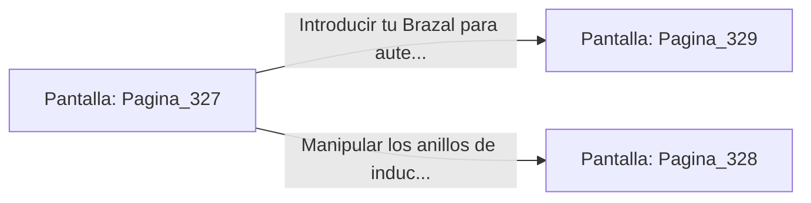

# 📺 Nodo Pantalla: `Pagina_327`

[[Index|⬅️ Índice]] | Fichero Origen: [[sample_eligejuego-code_capitulo_17_mpl|📄 sample/eligejuego-code/capitulo_17.mpl]]

**Narrativa y Encabezado:**
> PÁGINA 327: EL LABORATORIO DE INDUCCIÓN
> 
> Entras en el Laboratorio de Inducción, una amplia cámara acristalada dominada por tres anillos de cobre suspendidos electromagnéticamente sobre un pozo de vacío. La energía residual del Núcleo hace chispotear el aire con efluvios dorados.
> 
> En la consola de mandos principal se encuentra la clave para estabilizar las Cámaras 328 a 350 y desbloquear las puertas del Bastión Superior.
> 
> Tienes la opción de introducir tu Brazal para autenticar las claves o manipular los anillos de inducción para sobrecargar la subestación enemiga.

## 📋 Desglose de Instrucciones de Opciones
### `OPCION "Introducir tu Brazal para autenticar las claves y desbloquear el Bastión" CON_ACCION TRANSICIONAR_A Pagina_329`
* **Instrucción:** `OPCION` *(Manual: Mapea una entrada o botón interactivo de usuario. Vincular una acción como la invocación de una función C1, un método C2 o una transición C3.)*
* **Efecto de Control:** Dispara `TRANSICIONAR_A` hacia [[Pantalla_Pagina_329|📺 Pagina_329]]
### `OPCION "Manipular los anillos de inducción para provocar una sobrecarga" CON_ACCION TRANSICIONAR_A Pagina_328`
* **Instrucción:** `OPCION` *(Manual: Mapea una entrada o botón interactivo de usuario. Vincular una acción como la invocación de una función C1, un método C2 o una transición C3.)*
* **Efecto de Control:** Dispara `TRANSICIONAR_A` hacia [[Pantalla_Pagina_328|📺 Pagina_328]]

## 📊 Diagrama de Flujo e Interacción (Mermaid)

