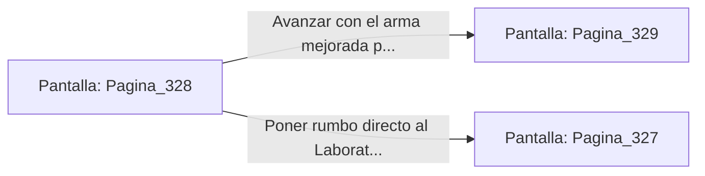

# 📺 Nodo Pantalla: `Pagina_328`

[[Index|⬅️ Índice]] | Fichero Origen: [[sample_eligejuego-code_capitulo_17_mpl|📄 sample/eligejuego-code/capitulo_17.mpl]]

**Narrativa y Encabezado:**
> PÁGINA 328: LA GEMA DE COMBATE OBTENIDA
> 
> Fuerzas la sobrecarga de cristalización en la consola y extraes una Gema de Combate de brillo purpúreo. Al adosarla a tu arma de fase, los proyectiles adquieren un efecto de dispersión térmica devastador.
> 
> Con la mejora en tu poder, esquivas la patrulla que acudía al ruido y te abres paso hacia el canal de drenaje.

## 📋 Desglose de Instrucciones de Opciones
### `OPCION "Avanzar con el arma mejorada por la ruta de drenaje" CON_ACCION TRANSICIONAR_A Pagina_329`
* **Instrucción:** `OPCION` *(Manual: Mapea una entrada o botón interactivo de usuario. Vincular una acción como la invocación de una función C1, un método C2 o una transición C3.)*
* **Efecto de Control:** Dispara `TRANSICIONAR_A` hacia [[Pantalla_Pagina_329|📺 Pagina_329]]
### `OPCION "Poner rumbo directo al Laboratorio de Inducción" CON_ACCION TRANSICIONAR_A Pagina_327`
* **Instrucción:** `OPCION` *(Manual: Mapea una entrada o botón interactivo de usuario. Vincular una acción como la invocación de una función C1, un método C2 o una transición C3.)*
* **Efecto de Control:** Dispara `TRANSICIONAR_A` hacia [[Pantalla_Pagina_327|📺 Pagina_327]]

## 📊 Diagrama de Flujo e Interacción (Mermaid)

